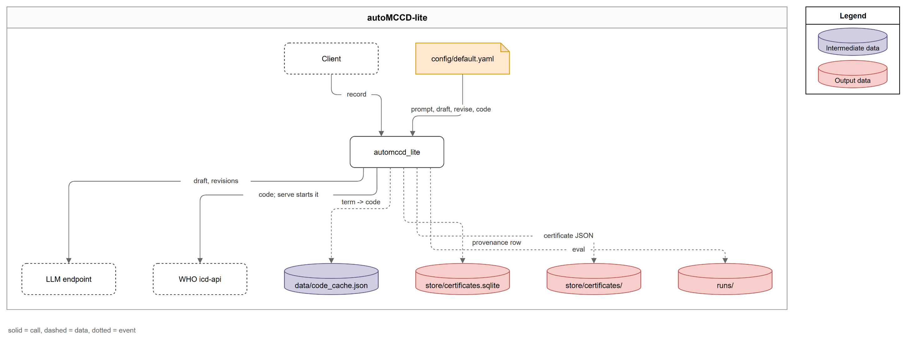

# Pipeline Architecture

## Overview

autoMCCD-lite turns your clinical death record into a coded death certificate and tells you whether a human must look at it before it counts. A language model writes the certificate, and ordinary code checks it against ten rules and the WHO's own coding tools, so the only part that can be wrong without a sign of it is followed by parts that give the same answer every time. Everything runs on one machine: a small web service, one container for the WHO tools, and a folder for the results.

The pipeline runs in three steps:

1. **Draft**: the model reads your record and writes a certificate in one call.
2. **Check**: the code checks the certificate against ten rules, codes it with the WHO tools, and gives the model one chance to fix a broken rule and one chance to restate a weakly coded term.
3. **Decide**: every problem the checks found becomes a reason code; no reasons means `auto`, any reason means `review`.

You provide one record per request; the pipeline produces the certificate, its ICD-11 codes, a route and the reasons, and saves them as a JSON file and a database row.

## The Parts of the System

The system has four parts, and only the WHO tools run in a container, because that is the only form in which the WHO ships them.

| Part | What it does | Where it runs | Source |
|---|---|---|---|
| The api | Takes your record on `POST /certify`, runs the three steps and saves the result. `/healthz` and `/readyz` report its state. | Your machine, on `127.0.0.1:8000` | `src/automccd_lite/api.py:72` |
| The model endpoint | Writes the draft and the two fixes. Any OpenAI-compatible chat completions service works. | Wherever `OPENAI_BASE_URL` points | `src/automccd_lite/config.py:78` |
| The WHO ICD-API | Codes each term (autocode), selects the underlying cause (DORIS) and runs the quality checks (CoDEdit). | A Docker container named `automccd-lite-icd`, on port 8082 | `src/automccd_lite/cli.py:31` |
| The store | Keeps one SQLite file and one folder of JSON files. | `store/` in the repo, or `STORE_DIR` | `src/automccd_lite/config.py:81` |

### What Happens to One Request

1. The api receives your record and calls `certify_record` (`src/automccd_lite/api.py:72`).
2. Step 1 builds the prompt and makes one model call (`src/automccd_lite/pipeline.py:68`).
3. Step 2 runs the rules, the fixes and the WHO coding (`src/automccd_lite/pipeline.py:76`).
4. Step 3 turns what the checks found into reasons and a route (`src/automccd_lite/decide.py:114`).
5. The api saves the result, the JSON file first and then the row (`src/automccd_lite/store.py:125`).
6. The api returns the response body to you (`src/automccd_lite/api.py:88`).

## Design Choices

### The Model Writes the Certificate and the Code Checks It

The model only writes the certificate, because it is the only part that understands a clinical narrative and also the only part that can be wrong without any sign of it. Every check after it is code that gives the same answer for the same input, so a certificate goes `auto` only when every check that code can make has passed.

- The route is `auto` only when the reason list is empty (`src/automccd_lite/decide.py:127`).

### The Model Replies in Strict JSON

The model call uses strict JSON schema decoding, so the reply has the certificate's shape by construction and no parser has to guess at its structure. Step 2 still checks the schema again, because the check costs microseconds and catches an endpoint that does not enforce strict mode.

- The call sends the schema with `strict: True` (`src/automccd_lite/draft.py:129`).
- Step 2 checks the schema before the rules (`src/automccd_lite/rules.py:578`).

### Every Line of the MCCD Inference Is Cited

Every certified line carries the exact words of your record that support it (the evidence span) and the name of the note they came from. A quote can be checked by string comparison even when the diagnosis cannot, so an invented diagnosis needs an invented quote, and rule 1 (exact quote) catches that quote.

- Rule 1 is the first of the ten rules that `check_rules` runs (`src/automccd_lite/rules.py:576`).

### The WHO Tools Assign the ICD-11 Codes

The ICD-11 codes and the underlying cause of death (UCOD) come from the WHO ICD-API, not from the model, because the cause selector (DORIS) applies the WHO's own selection rules and returns the same answer for the same certificate. A model asked for codes gives plausible codes with no guarantee that they follow those rules.

- The container image is pinned by its digest, so the ICD release and the selection rules do not change between runs (`src/automccd_lite/cli.py:33`).

:::{note}
The first `serve` pulls the WHO image and loads the release, which takes about a minute. The container then stays running between serves, so later starts take seconds. `uv run automccd-lite icd stop` removes it.
:::

### The Model Gets One Chance to Fix Each Problem

When a rule breaks, the model gets its draft back with the list of failures and one chance to fix it; when a term codes weakly, the model gets one chance to restate it as the standard ICD-11 name. One attempt each keeps the cost of a record predictable at three model calls or fewer, where a loop until the checks pass has no upper bound on calls or time.

Each fix has a guard. A rules fix is kept only if it keeps the same assessment, so the model cannot fix a quote by declaring your record out of scope. A restated term is kept only if it codes with a higher match score than the original, so a fix cannot make the coding worse. A certificate that needed a fix never routes `auto`, because a human must see what the model changed.

- Set the attempts with `check.fix_rules_attempts` and `check.fix_terms_attempts` (e.g. `0` turns a fix off) (`config/default.yaml:16`).
- The rules fix keeps the new certificate only when it answers the same question (`src/automccd_lite/rules.py:657`).
- The terms fix puts a restated term back when it does not code better (`src/automccd_lite/coding.py:382`).
- A fix adds `fix:rules` or `fix:terms` to the reasons (`src/automccd_lite/decide.py:58`).

### Reason Codes Set the Route, Not a Confidence Score

Step 3 has no confidence score and no threshold: every problem becomes a reason code in the form `source:what`, such as `rule:2` or `quality:FER-CE-931`, and any reason means `review`. A reviewer reads the list as a worklist, and you can trust that `auto` means every check passed, where a score needs a tuned threshold that hides which check failed. The full list of reasons is on the [Step 3. Decide](decide.md) page.

- Each broken rule becomes one `rule:<id>` reason (`src/automccd_lite/decide.py:56`).

### The Pipeline Returns the Result and the API Saves It

`certify_record` runs the three steps and returns a result without writing anything, and the api saves that result in a separate call. The same function therefore runs in the api, in the evaluation harness, which must not fill the store, and in the tests, where fakes replace the model and the WHO client.

- The model call, the WHO client and the term cache come in through `Deps` (`src/automccd_lite/pipeline.py:34`).

### The API Writes the JSON First and the DB Row Second

The api writes the response body to a JSON file and then one row to the `certificates` table with everything the body leaves out: the rule check, both fixes and the raw WHO replies. The row records the file's path and is written second, so a row never points at a missing file. SQLite and a folder need no database server and no cloud account, so the whole system runs on one laptop.

- The file goes to `store/certificates/{yyyy-mm-dd}/{hhmmss}Z_{record_id}.json`; the time prefix means a rerun of the same record never overwrites the first (`src/automccd_lite/store.py:45`).
- The row goes to `store/certificates.sqlite` in one transaction (`src/automccd_lite/store.py:134`).

### Every ICD-11 Code Is Cached Once Seen

The pipeline keeps every term the term coder (autocode) has seen in `data/code_cache.json`, which is tracked in git. A rerun makes no container call for a known term, and two people who run the same cases get the same codes.

- A save merges the entries that other writers added, so the api, the evaluation and the notebooks can share the file (`src/automccd_lite/coding.py:218`).

### Every Result Records the Versions

Every result carries the prompt version and its SHA-1 hash, the schema version, the model and the ICD release, so you can tell whether two results are comparable. The hash changes with any edit to the prompt, so results from different prompts never mix by accident.

- The versions block is built for every result (`src/automccd_lite/decide.py:101`).

### Patient Text Stays Out of the Logs

The api listens on the loopback address only, and the log writes only an allowlist of fields, so no note text and no certificate text reaches a log line. When the model endpoint is unreachable, the api answers 503 and saves nothing, so a retry starts clean. When the WHO container is down, your record still gets a result, routed `review` with the reason `who:unavailable`.

- The api binds to `127.0.0.1` unless `API_HOST` says otherwise (`src/automccd_lite/cli.py:147`).
- The log keeps only the allowlisted fields: the record id, the route, the reasons, the draft status, the timings and a few more (`src/automccd_lite/log.py:16`).
- A model outage becomes a 503 (`src/automccd_lite/api.py:66`).
- A WHO outage becomes `who:unavailable` (`src/automccd_lite/pipeline.py:95`).

## System Requirements

You need three tools and two values to run the pipeline.

| Requirement | Version or value | Description | Source |
|---|---|---|---|
| Python | 3.12 or later | uv installs it for you when it is missing. | `pyproject.toml:6` |
| uv | any recent version | Installs the locked dependencies and runs every command. | `uv.lock` |
| Docker | Docker Desktop or Docker Engine | Runs the WHO ICD-API container. | `src/automccd_lite/cli.py:76` |
| `OPENAI_BASE_URL` | e.g. `https://api.openai.com/v1` | The model endpoint. | `.env.example:6` |
| `OPENAI_API_KEY` | your key for that endpoint | Required; `/readyz` reports `model_configured: false` without it. | `.env.example:7` |
| `API_PORT` | `8000` | The port the api listens on. | `src/automccd_lite/config.py:82` |
| `ICD_PORT` | `8082` | The port of the WHO container. | `src/automccd_lite/cli.py:71` |
| Network | internet access | The first run pulls the container image once; every record reaches the model endpoint. | `src/automccd_lite/cli.py:87` |

A record takes a few seconds, nearly all of it the model call; the WHO calls take milliseconds.

:::{tip}
Two optional groups add tools for two commands: `uv sync --group notebooks` before `automccd-lite notebooks`, and `uv sync --group docs` before `automccd-lite docs`.
:::
