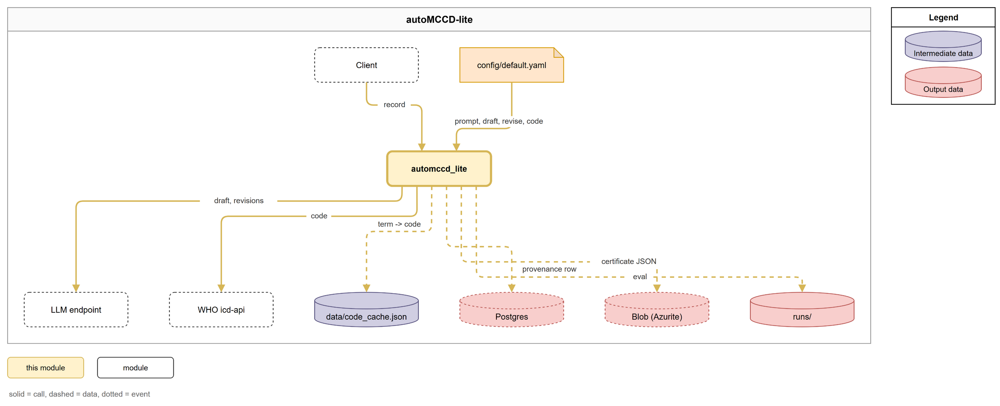
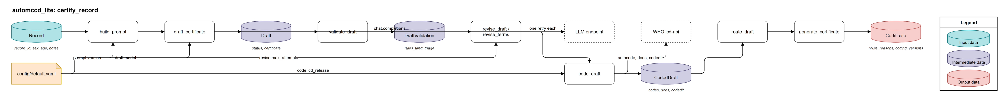
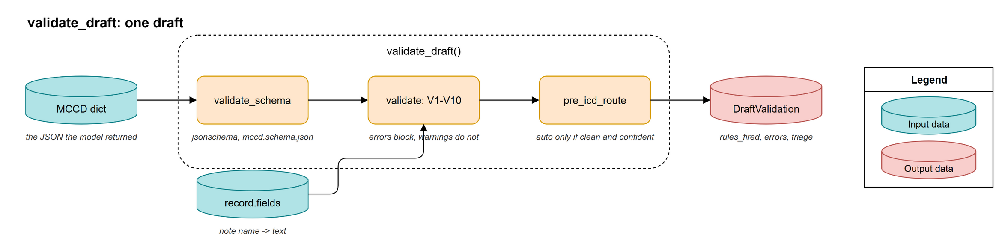
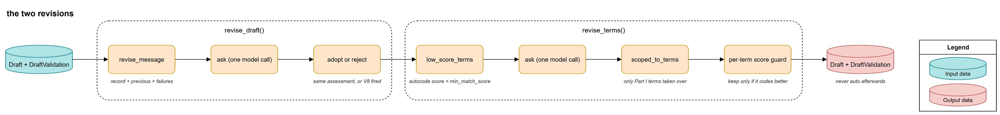
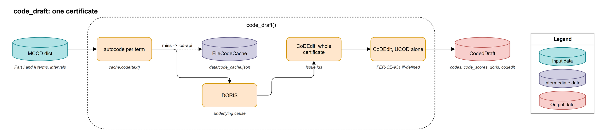
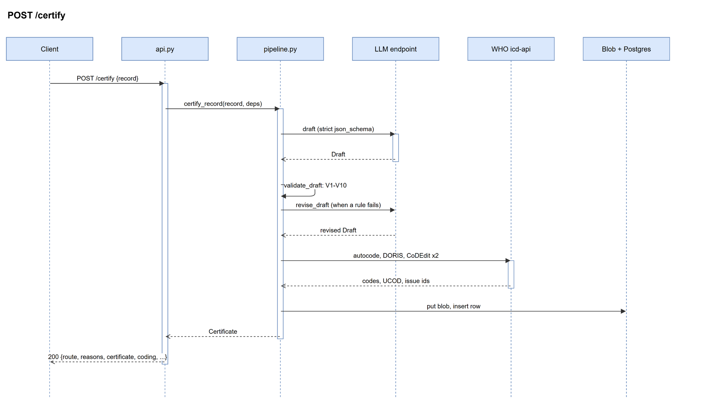
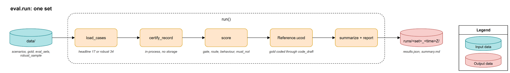

# automccd_lite User Guide

## Overview



The package turns one clinical record into a WHO Medical Certificate of Cause of Death coded in ICD-11, and tells you whether a human must look at it before it counts. A language model writes the draft; the code checks it against ten rules and the WHO's own coding tools, gives the model one chance to fix what failed, and then decides the route from what it could verify. The api calls it once per request, the evaluation harness calls it once per case, and the notebooks call its functions one at a time.

The module runs in seven stages:

1. **build_prompt**: renders your record as text and pairs it with the fixed system prompt.
2. **draft_certificate**: makes one model call with strict JSON-schema decoding.
3. **validate_draft**: checks the schema and the rules V1 to V10 against your record.
4. **revise_draft**: sends the failures back to the model once, and adopts the answer only if it still answers the same question.
5. **code_draft**: codes every term with autocode, selects the underlying cause with DORIS, and runs CoDEdit twice; inside it, **revise_terms** asks once for the standard name of a term autocode could not match.
6. **route_draft**: turns every finding into a reason code; no reasons means `auto`.
7. **generate_certificate**: builds the response and, in the api, writes the blob and the provenance row.

You provide a record with its notes and the demographics; the package produces a certificate with a route, its reasons, the codes and the versions that produced it.

## Inputs and Outputs

### Inputs

1. The request body of `POST /certify`, one record (JSON)

| Field | Type | Description | Source |
|---|---|---|---|
| `record_id` | `str` | Your identifier for the record; it comes back on the certificate. | `src/automccd_lite/models.py:45` |
| `sex` | `"male" \| "female" \| null` | Needed by DORIS; a missing value routes to review. | `src/automccd_lite/models.py:46` |
| `age`, `age_unit` | `float`, `minutes` to `years` | Given together or not at all. | `src/automccd_lite/models.py:47` |
| `context` | `str \| null` | Registry metadata the model may read but not cite. | `src/automccd_lite/models.py:49` |
| `notes` | `list[{name, text}]` | The free text, one entry per note; names must be unique. | `src/automccd_lite/models.py:50` |

2. `config/default.yaml` (the tuning by stage, see Quickstart)
3. `prompts/mccd/v4.7.md` and `prompts/schemas/mccd.schema.json` (the system prompt and the strict output schema, read once at import) (`src/automccd_lite/prompt.py:48`)
4. `data/code_cache.json` (the autocode cache, read at startup and rewritten on every new term) (`src/automccd_lite/code.py:207`)
5. The evaluation data under `data/`: `scenarios.json`, `demographics.json`, `eval_sets.json`, `gold/*.json`, `robust_sample.json` (`src/automccd_lite/eval.py:42`)

### Outputs

1. The response body of `POST /certify` (JSON)

| Field | Type | Description | Source |
|---|---|---|---|
| `record_id` | `str` | Echoed from the request. | `src/automccd_lite/models.py:184` |
| `route` | `"auto" \| "review"` | The decision. | `src/automccd_lite/models.py:185` |
| `reasons` | `list[str]` | Every reason code that kept the certificate from `auto`. | `src/automccd_lite/route.py:14` |
| `certificate` | `dict \| null` | The MCCD the model wrote, in the schema's shape. | `src/automccd_lite/models.py:187` |
| `coding` | `CodingSummary \| null` | `ucod_stem`, `ucod_full`, `codes`, `code_scores`, `codedit_issues`, `doris_warning`. | `src/automccd_lite/models.py:163` |
| `versions` | `Versions` | `prompt_version`, `prompt_sha1`, `schema_version`, `model`, `icd_release`, `automccd_version`. | `src/automccd_lite/models.py:172` |
| `usage` | `Usage` | Prompt, completion and reasoning tokens, and the number of model calls. | `src/automccd_lite/models.py:79` |
| `timings_ms` | `dict[str, int]` | Milliseconds per stage: `draft`, `validate`, `revise`, `code`, `route`. | `src/automccd_lite/pipeline.py:39` |

2. One row in the Postgres table `certificates` (the response plus the provenance the response leaves out)

| Field | Type | Description | Source |
|---|---|---|---|
| `record_id`, `route`, `reasons`, `draft_status` | `str`, `str`, `jsonb`, `str` | The decision and the model status. | `src/automccd_lite/db.py:34` |
| `versions`, `usage`, `timings_ms` | `jsonb` | As in the response. | `src/automccd_lite/db.py:41` |
| `certificate` | `jsonb` | The MCCD; it carries patient text. | `src/automccd_lite/db.py:42` |
| `validation` | `jsonb` | The gate's verdict, both revisions, the model's chain; it carries patient text. | `src/automccd_lite/db.py:43` |
| `coding` | `jsonb` | The raw autocode, DORIS and CoDEdit replies. | `src/automccd_lite/db.py:44` |
| `icd_error` | `str \| null` | `icd_unavailable` or `icd_error` when the WHO container failed. | `src/automccd_lite/db.py:45` |
| `blob_path` | `str \| null` | Where the JSON copy went. | `src/automccd_lite/db.py:48` |

3. One blob per certificate, `certificates/{yyyy-mm-dd}/{hhmmss}Z_{record_id}.json` (the response body, pretty-printed) (`src/automccd_lite/storage.py:22`)
4. `runs/<set>_<hhmmss>Z/results.json` and `summary.md` from the evaluation harness (`src/automccd_lite/eval.py:462`)
5. JSON log lines on stdout, one per certified record, restricted to an allowlist of fields that never carry patient text (`src/automccd_lite/log.py:16`)

## Folder Structure

```
src/automccd_lite/
├── __init__.py       # the version string
├── models.py         # Record, Draft, DraftValidation, CodedDraft, Route, Decision, Certificate
├── config.py         # settings(): config/default.yaml by stage plus the environment
├── log.py            # JSON logs with the PHI allowlist
├── prompt.py         # build_prompt: the system prompt, its sha1, the rendered record
├── draft.py          # draft_certificate: the one function that calls the model
├── validate.py       # validate_draft: rules V1 to V10, the schema check, the triage route
├── revise.py         # revise_draft and revise_terms: the two bounded second chances
├── code.py           # code_draft: the WHO icd-api client, the autocode cache
├── route.py          # route_draft: the reason codes and the two routes
├── certificate.py    # generate_certificate: the Certificate, the blob, the row, the response body
├── storage.py        # BlobStorage: Azurite or Azure Blob through a connection string
├── db.py             # the certificates table, create_all, the session, the store
├── pipeline.py       # certify_record: the seven stages in order; Deps
├── api.py            # FastAPI: POST /certify, /healthz, /readyz; Runtime built at startup
└── eval.py           # the mini harness: headline and robust sets, scoring, runs/ output
```

## Quickstart

:::{note}
The api needs the WHO icd-api container, Postgres and Azurite beside it; `make up` starts all four. The icd-api downloads its release on the first start and takes about a minute to turn healthy, and `/readyz` reports it as not ready until then.
:::

### 1. Give it a model endpoint

- Copy `.env.example` to `.env` and set `OPENAI_BASE_URL` (e.g. `https://api.openai.com/v1`) and `OPENAI_API_KEY`. Any OpenAI-compatible endpoint works; the model name comes from the config file, and `LLM_MODEL` in `.env` overrides it (e.g. `gpt-5-nano-2025-08-07`).

### 2. Tune the stages, if you want to

- Edit `config/default.yaml`: `draft.model`, `draft.reasoning_effort` (e.g. `minimal`, the setting the baseline numbers were measured with), `revise.max_attempts` (set `0` to switch the rule revision off), `code.min_match_score` (e.g. `0.5`: an autocode match below it triggers the terminology revision and the `autocode_low_score` reason).

### 3. Run it

```
make up          # Makefile:19
make smoke       # Makefile:31
```

`make smoke` ends with `SMOKE OK` after it has certified `data/records/S01.json` and found the row and the blob. Then send your own record:

```
curl -s -X POST localhost:8000/certify -H 'content-type: application/json' --data-binary @data/records/S02.json
```

### 4. Measure it

```
make eval                     # Makefile:37, the 17 headline cases
EVAL_SET=robust make eval     # the 34 stress cases, scored on behaviour
```

The run folder is printed last; read its `summary.md`. The harness runs in-process and reaches the icd-api on the host port, so the stack must be up.

### Configuration

| Key | Type | Default | Description | Source |
|---|---|---|---|---|
| `prompt.version` | `str` | `"4.7"` | Which `prompts/mccd/v<version>.md` to load. | `config/default.yaml:5` |
| `prompt.schema` | `str` | `"mccd"` | Which `prompts/schemas/<schema>.schema.json` to load. | `config/default.yaml:6` |
| `draft.model` | `str` | `"gpt-5-nano-2025-08-07"` | The model name; `LLM_MODEL` overrides it. | `config/default.yaml:9` |
| `draft.temperature` | `float \| null` | `null` | Not sent when null; reasoning models reject it. | `config/default.yaml:10` |
| `draft.seed` | `int \| null` | `20251023` | Best effort; this model is not deterministic with it. | `config/default.yaml:11` |
| `draft.reasoning_effort` | `str \| null` | `minimal` | Not sent when null; `minimal` costs no reasoning tokens. | `config/default.yaml:12` |
| `draft.max_completion_tokens` | `int` | `8000` | Must cover hidden reasoning; 2000 returned nothing. | `config/default.yaml:13` |
| `draft.timeout_s`, `draft.max_retries` | `float`, `int` | `120`, `4` | Per model call; the SDK retries 429 and 5xx. | `config/default.yaml:14` |
| `revise.max_attempts` | `int` | `1` | Rule revisions per record; `0` switches them off. | `config/default.yaml:18` |
| `revise.term_max_attempts` | `int` | `1` | Terminology revisions per record. | `config/default.yaml:19` |
| `code.icd_release` | `str` | `"2026-01"` | Must match the release the icd-api image serves. | `config/default.yaml:22` |
| `code.min_match_score` | `float` | `0.5` | The autocode score under which a term counts as unmatched. | `config/default.yaml:24` |
| `code.timeout_s`, `code.max_retries` | `float`, `int` | `30`, `2` | Per icd-api call. | `config/default.yaml:25` |
| `OPENAI_BASE_URL`, `OPENAI_API_KEY` | env | none | The model endpoint; never logged. | `src/automccd_lite/config.py:85` |
| `LLM_MODEL` | env | unset | Overrides `draft.model`. | `src/automccd_lite/config.py:82` |
| `ICD_API_URL` | env | `http://localhost:8082` | The icd-api as seen from the process; compose sets `http://icd-api:80` inside the container. | `src/automccd_lite/config.py:87` |
| `AZURE_STORAGE_CONNECTION_STRING`, `AZURE_STORAGE_CONTAINER` | env | none, `certificates` | The blob account and container. | `src/automccd_lite/config.py:88` |
| `PGHOST`, `PGPORT`, `PGDATABASE`, `PGUSER`, `PGPASSWORD` | env | from `.env.example` | Read by psycopg; the URL names no host. | `src/automccd_lite/db.py:23` |
| `API_HOST`, `API_PORT` | env | `0.0.0.0`, `8000` | Where uvicorn listens. | `src/automccd_lite/api.py:147` |

## Components



| Component | Lives in | Description |
|---|---|---|
| models | `src/automccd_lite/models.py:41` | The types that flow between the stages. |
| config | `src/automccd_lite/config.py:79` | The settings, from the YAML file and the environment. |
| log | `src/automccd_lite/log.py:64` | JSON log lines filtered through an allowlist. |
| prompt | `src/automccd_lite/prompt.py:89` | The system prompt and the rendered record. |
| draft | `src/automccd_lite/draft.py:125` | The one model call. |
| validate | `src/automccd_lite/validate.py:569` | The ten rules and the triage route. |
| revise | `src/automccd_lite/revise.py:74` | The rule revision and the terminology revision. |
| code | `src/automccd_lite/code.py:257` | The WHO tools and the autocode cache. |
| route | `src/automccd_lite/route.py:14` | The reason codes and the route. |
| certificate | `src/automccd_lite/certificate.py:66` | The Certificate, its storage and its response body. |
| storage | `src/automccd_lite/storage.py:27` | The blob adapter. |
| db | `src/automccd_lite/db.py:30` | The certificates table and its store. |
| pipeline | `src/automccd_lite/pipeline.py:45` | The seven stages in order. |
| api | `src/automccd_lite/api.py:125` | The three routes and the runtime built at startup. |
| eval | `src/automccd_lite/eval.py:462` | The mini harness. |

### models

The pydantic types every stage reads and writes, so a stage's contract is visible in one file. The MCCD itself stays a dict: it is the JSON the model returned under the strict schema.

#### Inputs and Outputs

- In: the request body, validated into `Record`; note names must be unique and age needs its unit (`src/automccd_lite/models.py:53`)
- Out: `Draft`, `DraftValidation`, `CodedDraft`, `Decision`, `Certificate` (`src/automccd_lite/models.py:97`)

#### Things to Note

- `Route` has two values, `auto` and `review`; a declined record is `review` with an `assessment:out_of_scope` or `assessment:insufficient` reason, where the full autoMCCD has four routes (`src/automccd_lite/models.py:110`).

### config

Reads the tuning by stage from the YAML file and the endpoints and secrets from the environment, once, and caches the result. It loads `.env` from the repository root first, so the api, the harness and the notebooks all see the same values.

#### Inputs and Outputs

- In: `config/default.yaml`, the `.env` file and the process environment (`src/automccd_lite/config.py:79`)
- Out: one `Settings` object with `prompt`, `draft`, `revise`, `code` and `env` (`src/automccd_lite/config.py:65`)

### log

Writes one JSON line per event and drops every field that is not on the allowlist, so a call site can only log less, never leak more. The HTTP client loggers stay at WARNING because the icd-api URLs carry certified terms.

#### Inputs and Outputs

- In: an event name and keyword fields (`src/automccd_lite/log.py:64`)
- Out: a JSON line on stdout with `ts`, `level`, `logger`, `event` and the allowed fields (`src/automccd_lite/log.py:40`)

#### Things to Note

- The uvicorn access log is disabled, because request URLs can carry identifiers; the api logs its own `certified` event instead (`src/automccd_lite/log.py:59`).

### prompt

Assembles the system prompt from the prompt file, the schema and one reply rule, hashes it, and renders your record as the user message. Nothing in the assembly may change by a byte: evaluated runs are identified by that hash.

#### Inputs and Outputs

- In: `prompts/mccd/v<version>.md`, `prompts/schemas/<schema>.schema.json`, a `Record` (`src/automccd_lite/prompt.py:48`)
- Out: a `Prompt` with `system`, `user` and `sha1` (`src/automccd_lite/prompt.py:89`)

### draft

Makes the one call to the model with the response forced into the schema, and turns the reply into a `Draft` whose status says what came back: `ok`, `refused`, `truncated` or `invalid`. It never raises on what the model said; it raises `ModelUnavailable` only when the service could not be reached after the SDK's retries, so the api can answer 503 and store nothing.

#### Inputs and Outputs

- In: the user message, with the system prompt, the schema and the draft settings fixed by `asker` (`src/automccd_lite/draft.py:117`)
- Out: a `Draft` with the status, the parsed certificate, the model name, the usage and the seconds (`src/automccd_lite/draft.py:55`)

#### Configuration

| Name | Type | Default | Where read |
|---|---|---|---|
| `draft.temperature`, `draft.seed`, `draft.reasoning_effort` | optional | `null`, `20251023`, `minimal` | `src/automccd_lite/draft.py:69` |
| `draft.max_completion_tokens` | int | `8000` | `src/automccd_lite/draft.py:65` |

### validate

The deterministic gate. Checks the schema again, runs the rules V1 to V10 against the text of your notes, and gives the gate's own opinion of the route, which the router may only tighten.



#### Inputs and Outputs

- In: the MCCD dict and `record.fields`, the note name to text map (`src/automccd_lite/validate.py:569`)
- Out: a `DraftValidation` with `schema_ok`, `validator_passed`, `rules_fired`, `errors`, `warnings`, the model's `assessment` and `confidence`, and `triage` (`src/automccd_lite/validate.py:577`)

#### Things to Note

- V2 fires on a mode of dying on any Part I line, but the bare "shock" and "heart failure" check runs on line 1a only; "congestive heart failure" on 1a is allowed, because the S17 gold certificate writes it there (`src/automccd_lite/validate.py:69`).
- A five-line Part I is a warning, not an error: the WHO form has four lines but DORIS accepts five, and the S14 gold uses all five (`src/automccd_lite/validate.py:315`).

### revise

Two bounded second chances, one model call each. The rule revision runs when the gate fails and is adopted only if the answer keeps the same assessment. The terminology revision runs inside coding when a Part I term scores under the threshold; only its Part I terms are taken over, and each restated term is kept only if it codes with a higher score than the original.



#### Inputs and Outputs

- In: the `Draft`, its `DraftValidation`, the record, the model call, and for the terminology revision the autocode cache and `code.min_match_score` (`src/automccd_lite/revise.py:171`)
- Out: the draft and validation the pipeline goes on with; the returned draft's usage includes the revision call (`src/automccd_lite/revise.py:102`)

#### Things to Note

- Adopted or rejected, a draft that needed a revision never routes `auto`; `never_auto` tightens the triage and the router adds `revised` (`src/automccd_lite/validate.py:593`).

### code

The client for the self-hosted WHO icd-api (autocode, DORIS, CoDEdit), the autocode cache, and `code_draft`, which runs the four calls on one certificate. CoDEdit runs twice because a validity error on the whole certificate suppresses its clinical checks; the second call sends the selected underlying cause alone.



#### Inputs and Outputs

- In: the MCCD dict, the demographics (`sex`, `age_iso`), the cache and the client (`src/automccd_lite/code.py:257`)
- Out: a `CodedDraft` with the codes per line, the match scores, the DORIS reply and both CoDEdit replies (`src/automccd_lite/code.py:272`)

#### Configuration

| Name | Type | Default | Where read |
|---|---|---|---|
| `ICD_API_URL` | env | `http://localhost:8082` | `src/automccd_lite/api.py:57` |
| `code.icd_release`, `code.linearization` | str | `"2026-01"`, `"mms"` | `src/automccd_lite/code.py:89` |

#### Things to Note

- The cache file is shared by the api container (through the compose bind mount), the harness and the notebooks; a save re-reads the file and merges before it rewrites, so no writer drops another's entries (`src/automccd_lite/code.py:221`).
- All three request headers are required: without `Accept` the container answers 412, without `API-Version` 400 (`src/automccd_lite/code.py:42`).

### route

A table, not a judgement. Every finding becomes a stable reason code; no reasons means `auto`, any reason means `review`. There is no score and no threshold, which is why a reviewer can trust that `auto` means every check passed.

#### Inputs and Outputs

- In: the record, the draft, the validation, the coded draft, the icd error and `code.min_match_score` (`src/automccd_lite/route.py:14`)
- Out: a `Decision` with the route and the reasons, in a fixed order: model status, assessment, schema, rules, revisions, confidence, coding, demographics (`src/automccd_lite/route.py:64`)

### certificate

Builds the `Certificate` from everything the stages produced and, when the api passes a storage and a store, writes the blob first and then the row. `as_response` is the subset the api returns: the provenance stays in the row.

#### Inputs and Outputs

- In: the record, the draft, the validation, the coded draft, the icd error, the decision, the usage, the timings, and optionally a `Storage` and a `CertificateStore` (`src/automccd_lite/certificate.py:66`)
- Out: a `Certificate`; the response body excludes `validation`, `coded`, `icd_error` and `draft_status` (`src/automccd_lite/certificate.py:101`)

### storage

Writes the response body as JSON to a blob container through a connection string, creating the container on first use. The blob name carries the time, so a re-run of the same record never collides with the first.

#### Inputs and Outputs

- In: a `Certificate` (`src/automccd_lite/storage.py:40`)
- Out: the blob `certificates/{yyyy-mm-dd}/{hhmmss}Z_{record_id}.json` and its path, returned for the row (`src/automccd_lite/storage.py:22`)

### db

The one table, `certificates`, its engine and session, `create_all`, and the store that inserts a row from a `Certificate`. There are no migrations: the api creates the table at startup.

#### Inputs and Outputs

- In: a `Certificate` and the blob path (`src/automccd_lite/db.py:83`)
- Out: one row in `certificates` (`src/automccd_lite/db.py:30`)

#### Things to Note

- The connection URL is `postgresql+psycopg://` with no host, so psycopg reads `PGHOST`, `PGPORT`, `PGDATABASE`, `PGUSER` and `PGPASSWORD` from the environment and no secret is ever in a string this package logs (`src/automccd_lite/db.py:23`).

### pipeline

`certify_record`: the seven stages in order, with a timer per stage. The collaborators come in through `Deps`, so the same function runs with the real model and coder in the api and with fakes in the tests.

#### Inputs and Outputs

- In: a `Record` and a `Deps` with `ask`, `icd`, `cache`, and optionally `storage` and `store` (`src/automccd_lite/pipeline.py:26`)
- Out: a `Certificate` (`src/automccd_lite/pipeline.py:45`)

#### Things to Note

- Coding runs only when the validation's assessment is `certifiable`; a declined record skips the WHO calls and routes to review on its assessment alone (`src/automccd_lite/pipeline.py:65`).

### api

The FastAPI app: `POST /certify` runs one record in the request, in one transaction; `/healthz` answers at once; `/readyz` probes Postgres, the icd-api, the blob container and the model configuration. The `Runtime` built at startup holds the model client, the icd client, the cache and the storage.



#### Inputs and Outputs

- In: `POST /certify` with a `Record` body (`src/automccd_lite/api.py:125`)
- Out: `200` with the response body; `503 {"detail": "model unavailable; retry later"}` when the model could not be reached; `GET /readyz` returns `{"ready", "components"}` with status `503` until every component is true (`src/automccd_lite/api.py:119`)

#### Configuration

| Name | Type | Default | Where read |
|---|---|---|---|
| `API_HOST`, `API_PORT` | env | `0.0.0.0`, `8000` | `src/automccd_lite/api.py:147` |

### eval

The mini harness. Builds the 17 headline cases from the scenarios, the demographics and the gold, or loads the 34 stress cases, runs `certify_record` in-process with no storage, scores each case, and writes a run folder. The gold is coded through the same `code_draft`, so the UCOD comparison is code against code.



#### Inputs and Outputs

- In: `--set headline|robust` and `--only` ids, parents or variants (`src/automccd_lite/eval.py:571`)
- Out: `runs/<set>_<hhmmss>Z/results.json` with `manifest`, `summary` and `cases`, and `summary.md` with the four numbers and a per-case table (`src/automccd_lite/eval.py:517`)

#### Things to Note

- The headline case ids are `<parent>-clean`, the ids the full autoMCCD harness uses, so the two runs compare case by case (`src/automccd_lite/eval.py:118`).

## Data Flow


1. The api validates the body into a `Record` and opens one database transaction (`src/automccd_lite/api.py:72`).
2. `build_prompt` renders the record and `draft_certificate` makes one model call under the strict schema (`src/automccd_lite/pipeline.py:49`).
3. `validate_draft` checks the schema and the rules V1 to V10 against the notes (`src/automccd_lite/pipeline.py:57`).
4. When a rule failed, `revise_draft` sends the failures back once and adopts the answer only if it keeps the assessment (`src/automccd_lite/pipeline.py:61`).
5. For a certifiable draft, `revise_terms` restates weak terms once, then `code_draft` runs autocode, DORIS and CoDEdit twice; a container failure becomes `icd_unavailable` or `icd_error` instead of an exception (`src/automccd_lite/pipeline.py:65`).
6. `route_draft` turns every finding into a reason code and picks `auto` or `review` (`src/automccd_lite/pipeline.py:81`).
7. `generate_certificate` writes the blob, inserts the row, and returns the `Certificate`; the api commits the transaction and answers with `as_response` (`src/automccd_lite/certificate.py:94`).
