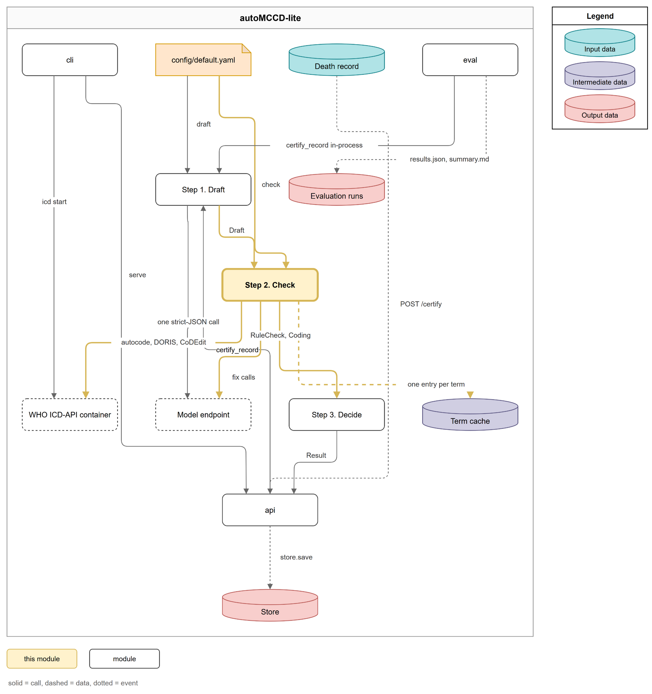
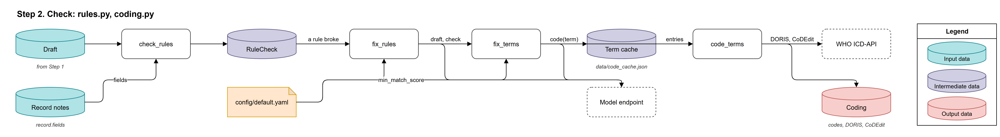
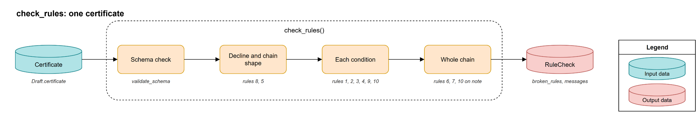
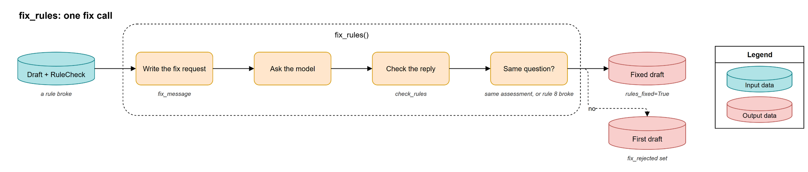
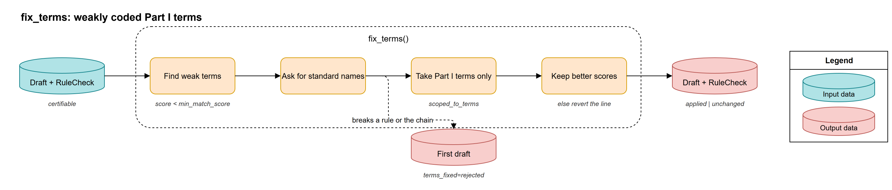
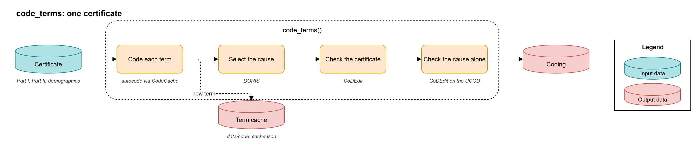
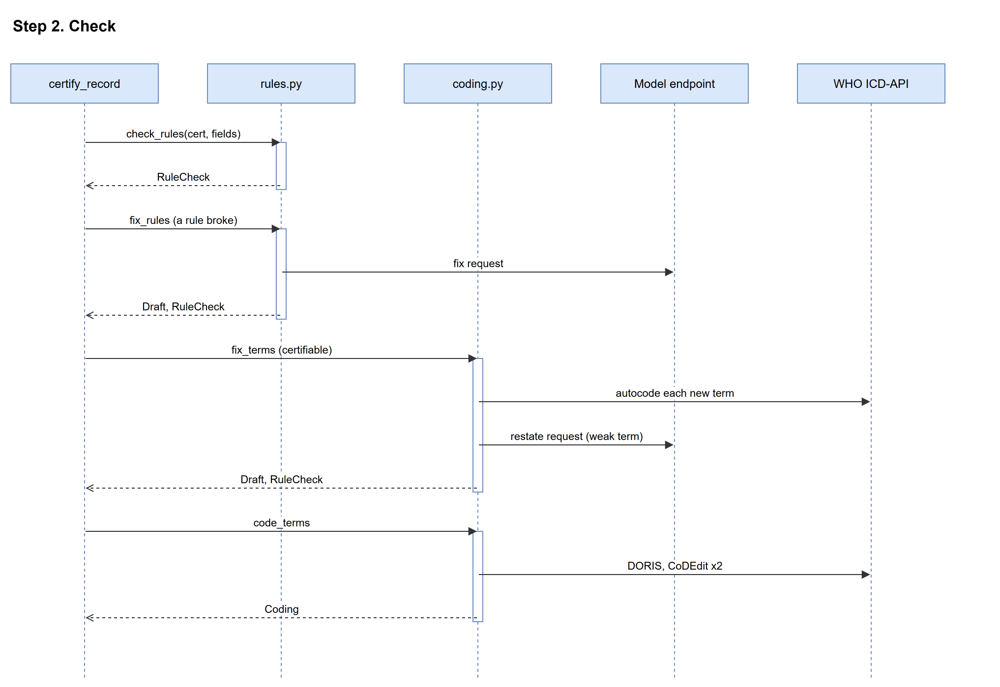

# Step 2. Check

## Overview



The Check step tests the drafted certificate against ten rules and codes it with the WHO's own tools. The rules run in code, because a model asked to check its own answer fails in exactly the cases that matter. When a rule breaks, the model gets one chance to fix it. When the WHO term coder (autocode) matches a Part I condition only weakly, the model gets one chance to restate that condition under its standard ICD-11 name. Then every condition is coded, the WHO cause selector (DORIS) picks the underlying cause of death (UCOD), and the WHO quality checks (CoDEdit) look at the certificate as a whole and at the underlying cause alone.

The step runs in four parts:

1. **Check the rules**: `check_rules` validates the certificate against the schema and the rules 1 to 10, using the text of your notes.
2. **Fix the rules**: `fix_rules` asks the model once for a corrected certificate when a rule broke or the reply did not parse.
3. **Fix the terms**: `fix_terms` asks the model once to restate the Part I terms that code under `check.min_match_score`.
4. **Code the terms**: `code_terms` codes each term through the term cache, then calls the cause selector (DORIS) and the quality checks (CoDEdit) twice.

You provide the draft from Step 1 and your record's notes; the step produces a rule check (`RuleCheck`) and a coding (`Coding`) for Step 3, and adds every newly coded term to `data/code_cache.json`.

## Inputs and Outputs

### Inputs

1. The draft from Step 1 (a `Draft`; see [Step 1. Draft](draft.md#outputs))
2. Your record's notes and demographics (`record.fields`, `record.demographics`)

| Field | Type | Description | Source |
|---|---|---|---|
| `fields` | `dict[str, str]` | Note name to note text; rule 1 looks up each evidence span here. | `src/automccd_lite/models.py:62` |
| `demographics` | `dict` | Sex and the age as an ISO-8601 duration, sent to the cause selector and the quality checks. | `src/automccd_lite/models.py:71` |

3. `data/code_cache.json` (JSON, one entry per term, keyed by the term in lower case with single spaces)

| Field | Type | Description | Source |
|---|---|---|---|
| `query` | `str` | The term as it was sent. | `src/automccd_lite/coding.py:146` |
| `code` | `str` or `null` | The ICD-11 code the term coder returned. | `src/automccd_lite/coding.py:147` |
| `matched_text` | `str` or `null` | The ICD-11 text the term matched. | `src/automccd_lite/coding.py:148` |
| `match_score` | `float` or `null` | How closely the term matched. | `src/automccd_lite/coding.py:149` |
| `uri` | `str` or `null` | The foundation or linearization URI of the match. | `src/automccd_lite/coding.py:150` |
| `adjudicated` | `bool` | `false` when coded; a human can set it to `true` after review. | `src/automccd_lite/coding.py:151` |

4. The WHO ICD-API container (HTTP, `ICD_API_URL`): the term coder, the cause selector and the quality checks
5. `config/default.yaml`, section `check` (see Quickstart)

### Outputs

1. The rule check (a `RuleCheck`, in memory)

| Field | Type | Description | Source |
|---|---|---|---|
| `schema_ok` | `bool` | The certificate matches the output schema. | `src/automccd_lite/models.py:121` |
| `rules_passed` | `bool` | No rule broke with an error. | `src/automccd_lite/models.py:122` |
| `broken_rules` | `list[str]` | The ids of the rules with an error, e.g. `["2"]`. | `src/automccd_lite/models.py:123` |
| `messages` | `list[str]` | Every error and warning, readable, e.g. `Rule 2 mode of dying (error, 1a): ...`. | `src/automccd_lite/models.py:124` |
| `assessment`, `decline_reason`, `confidence`, `flags` | copied from the certificate | What the model concluded and how sure it was. | `src/automccd_lite/models.py:125` |
| `model_chain` | `list[str]` | The Part I terms, 1a first. | `src/automccd_lite/models.py:129` |
| `rules_fixed`, `before_fix`, `fix_rejected` | `bool`, `dict`, `str` | Whether the rules fix was adopted, the state before it, or why it was rejected. | `src/automccd_lite/models.py:131` |
| `terms_fixed` | `applied`, `unchanged`, `rejected` or `None` | What the terms fix did. | `src/automccd_lite/models.py:134` |
| `term_changes`, `term_reverted` | `list` | The terms the fix changed, and the restated terms it put back because they coded worse. | `src/automccd_lite/models.py:135` |

2. The coding (a `Coding`, in memory, only for a `certifiable` certificate)

| Field | Type | Description | Source |
|---|---|---|---|
| `codes` | `dict` | `{"part1": [...], "part2": [...]}`, one ICD-11 code per term, `None` where the term did not code. | `src/automccd_lite/models.py:146` |
| `uncoded_part1` | `list[int]` | The Part I lines with no code. | `src/automccd_lite/models.py:147` |
| `match_scores` | `list[float or None]` | The match score of each Part I term. | `src/automccd_lite/models.py:148` |
| `autocode` | `list[dict]` | The cache entry of every term. | `src/automccd_lite/models.py:149` |
| `doris` | `dict` | The cause selector's reply: `ucod_code`, `ucod_stem_code`, `report`, `warning` and more. | `src/automccd_lite/coding.py:157` |
| `codedit` | `dict` | The quality checks on the whole certificate: `issue_ids` and named flags. | `src/automccd_lite/coding.py:172` |
| `codedit_cause` | `dict` or `None` | The quality checks on the underlying cause alone. | `src/automccd_lite/models.py:152` |

3. The draft after the fixes (a `Draft`), with the usage of every fix call added
4. `data/code_cache.json`, rewritten when a new term was coded
5. An error code instead of a coding when the container failed: `who:unavailable` or `who:error` (`src/automccd_lite/pipeline.py:95`)

## Folder Structure

```
src/automccd_lite/
├── rules.py               # check_rules, the rules 1 to 10, RULE_NAMES, fix_rules
└── coding.py              # WhoClient, CodeCache, code_terms, fix_terms
data/
└── code_cache.json        # one autocode entry per term, tracked in git
config/
└── default.yaml           # the check section
```

## Quickstart

:::{note}
The Check step needs the WHO ICD-API container running and the model key in `.env`. Start the container alone with `uv run automccd-lite icd start`, or leave `uv run automccd-lite serve` running. New terms are written to `data/code_cache.json`.
:::

### 1. Start the WHO ICD-API container

```
uv run automccd-lite icd start      # src/automccd_lite/cli.py:82
```

- The container listens on `ICD_PORT` (default `8082`) and the code reaches it at `ICD_API_URL` (default `http://localhost:8082`).

### 2. Draft the example record

- The code below drafts `data/examples/S01.json` as in [Step 1](draft.md#quickstart). The draft's status must be `ok` for `check_rules` to have a certificate to read.

### 3. Run the four parts

Start `uv run python` in the repository root and run:

```python
import json
from automccd_lite.config import settings
from automccd_lite.models import Record
from automccd_lite.pipeline import build_deps
from automccd_lite.draft import draft_certificate
from automccd_lite.rules import check_rules, fix_rules, needs_fix
from automccd_lite.coding import fix_terms, code_terms

record = Record(**json.load(open("data/examples/S01.json", encoding="utf-8")))
deps = build_deps()  # src/automccd_lite/pipeline.py:50
draft = draft_certificate(record, deps.ask)

check = check_rules(draft.certificate, record.fields)  # src/automccd_lite/rules.py:576
print(check.rules_passed, check.messages)
if needs_fix(draft, check):
    draft, check = fix_rules(record, draft, check, deps.ask)  # src/automccd_lite/rules.py:647

if check.assessment == "certifiable":
    min_score = settings().check.min_match_score
    draft, check = fix_terms(
        record, draft, check, deps.cache, deps.ask, min_score
    )  # src/automccd_lite/coding.py:344
    coding = code_terms(
        draft.certificate, deps.cache, deps.who, record.demographics
    )  # src/automccd_lite/coding.py:254
    print(coding.codes, coding.doris["ucod_stem_code"], coding.codedit["issue_ids"])
```

You should see the rule messages, then the ICD-11 codes per Part, the underlying cause's stem code, and the quality issue ids (an empty list when the certificate is clean).

### Configuration

| Key | Type | Default | Description | Source |
|---|---|---|---|---|
| `check.fix_rules_attempts` | `int` | `1` | Model calls to fix broken rules; `0` turns the fix off. | `config/default.yaml:16` |
| `check.fix_terms_attempts` | `int` | `1` | Model calls to restate weakly coded terms; `0` turns the fix off. | `config/default.yaml:17` |
| `check.min_match_score` | `float` | `0.5` | A match below this is weak: it triggers the terms fix, and Step 3 reads it for `who:low_match`. | `config/default.yaml:18` |
| `check.icd_release` | `str` | `"2026-01"` | Must match the release the container image serves. | `config/default.yaml:19` |
| `check.linearization` | `str` | `"mms"` | The ICD-11 linearization the term coder uses. | `config/default.yaml:20` |
| `check.timeout_s` | `float` | `30` | The timeout of one container call. | `config/default.yaml:21` |
| `check.max_retries` | `int` | `2` | Retries on a transport error or a 5xx. | `config/default.yaml:22` |
| `ICD_API_URL` | env | `http://localhost:8082` | Where the code reaches the container. | `src/automccd_lite/config.py:80` |
| `ICD_PORT` | env | `8082` | The host port `icd start` publishes the container on. | `src/automccd_lite/cli.py:71` |

## Components



| Component | Lives in | Description |
|---|---|---|
| check_rules | `src/automccd_lite/rules.py:576` | Tests the certificate against the schema and the rules 1 to 10. |
| fix_rules | `src/automccd_lite/rules.py:647` | Gives the model one chance to fix what failed. |
| fix_terms | `src/automccd_lite/coding.py:344` | Gives the model one chance to restate weakly coded Part I terms. |
| code_terms | `src/automccd_lite/coding.py:254` | Codes every term and asks the cause selector and the quality checks about the certificate. |

### check_rules

The rule checker gives a verdict the model cannot argue with: the certificate is tested against the output schema again (`validate_schema`), then against the ten rules, using the text of your notes (`apply_rules`). An error blocks `auto` and triggers the rules fix; a warning is recorded for the reviewer and blocks nothing.



#### Inputs and Outputs

- In: the certificate dict and `record.fields` (`src/automccd_lite/rules.py:576`)
- Out: a `RuleCheck`, with at most five schema errors in `messages` (`src/automccd_lite/rules.py:583`)

#### The Rules

The rule id and name come from `RULE_NAMES`; the "Checked at" line is where the check starts in `apply_rules`.

| Rule | Name | What it checks | Severity | Source |
|---|---|---|---|---|
| 1 | exact quote | Each evidence span appears word for word in the note its `evidence_field` names, up to whitespace, case, typographic quotes and dashes, and hyphens a line break made. An inferred condition (`clinical_inference`, `absent`) needs no span but needs a `review.note`. | error; warning for an inferred condition | `src/automccd_lite/rules.py:158`, checked at `src/automccd_lite/rules.py:370` |
| 2 | mode of dying | No Part I line is a mode of dying such as cardiac arrest, respiratory failure or old age; line 1a is not a bare "heart failure" or "shock" without a qualifier such as "congestive" or "septic". | error | `src/automccd_lite/rules.py:159`, checked at `src/automccd_lite/rules.py:410` |
| 3 | one cause per line | No term joins two conditions with "and", "with", "plus", a comma, a semicolon, a slash or "+", except in names such as "chronic obstructive pulmonary disease". | error in Part I, warning in Part II | `src/automccd_lite/rules.py:160`, checked at `src/automccd_lite/rules.py:436` |
| 4 | no abbreviations | No listed abbreviation (MI, CVA, COPD, CKD and more) in upper case; HIV, AIDS and TB are allowed. | error | `src/automccd_lite/rules.py:161`, checked at `src/automccd_lite/rules.py:450` |
| 5 | chain shape | Part I has no empty or repeated term and at most five lines: five is a warning, six an error. A `review.note` over 300 characters is a warning. | error, or warning | `src/automccd_lite/rules.py:162`, checked at `src/automccd_lite/rules.py:329` |
| 6 | interval order | The known Part I intervals do not decrease from 1a down. An unknown interval is skipped, with a warning when the `interval_undocumented` flag is missing. | error | `src/automccd_lite/rules.py:163`, checked at `src/automccd_lite/rules.py:482` |
| 7 | Part II overlap | No Part II term repeats a Part I term; more than four Part II entries is a warning. | error | `src/automccd_lite/rules.py:164`, checked at `src/automccd_lite/rules.py:520` |
| 8 | decline consistency | A declined certificate has no Part I chain and states a decline reason; a certifiable one has a chain and no decline reason. | error | `src/automccd_lite/rules.py:165`, checked at `src/automccd_lite/rules.py:301` |
| 9 | no codes in terms | No ICD-10 or ICD-11 code inside a certified term; coding is the WHO tools' work. | error | `src/automccd_lite/rules.py:166`, checked at `src/automccd_lite/rules.py:459` |
| 10 | no identifiers | No phone number, NIC, email or street address in a term, an evidence span, `review.note` or `decline_reason`. Names have no pattern and are not checked. | error | `src/automccd_lite/rules.py:167`, checked at `src/automccd_lite/rules.py:470` |

#### Things to Note

- "Congestive heart failure" on line 1a passes rule 2: only the unqualified "heart failure" fails, because the WHO avoid-list asks for the type to be named, and the S17 reference certificate puts congestive heart failure on 1a (`src/automccd_lite/rules.py:51`).

### fix_rules

The rules fix gives the model one bounded second chance when the certificate failed a rule or the schema, or the reply did not parse. The fix request carries your rendered record, the previous answer (up to 6000 characters) and the failures in short form, and asks for the corrected object in full with only the failures changed (`fix_message`). The fixed certificate replaces the first one only if it still answers the same question: it parses, and it keeps the assessment unless the first draft broke rule 8 itself. Adopted or rejected, Step 3 adds `fix:rules`, so a fixed certificate never goes `auto`.



#### Inputs and Outputs

| Direction | What | Source |
|---|---|---|
| In | The record, the draft, its `RuleCheck` (or `None` when the reply did not parse) and the `Ask` | `src/automccd_lite/rules.py:647` |
| Out | The fixed draft and its new `RuleCheck`, with `rules_fixed` and `before_fix` set | `src/automccd_lite/rules.py:662` |
| Out | The first draft and its `RuleCheck`, with `fix_rejected` set, when the fix did not parse or changed the assessment | `src/automccd_lite/rules.py:675` |

#### Configuration

| Name | Type | Default | Where read |
|---|---|---|---|
| `check.fix_rules_attempts` | `int` | `1` | `src/automccd_lite/pipeline.py:83` |

### fix_terms

The terms fix helps a condition the term coder (autocode) cannot match well: it lists each Part I term whose match score is missing or under `check.min_match_score`, with its closest ICD-11 match, and asks the model once for the standard ICD-11 name of the same condition. The reply must still pass every rule, keep the assessment and keep the number of Part I lines. Only its Part I terms are taken over (`scoped_to_terms`); every other field stays as it was. Each restated term is then kept only if it codes with a higher score than the original, so a fix cannot make the coding worse.



#### Inputs and Outputs

| Direction | What | Source |
|---|---|---|
| In | The record, the draft, its `RuleCheck`, the term cache, the `Ask` and the minimum score | `src/automccd_lite/coding.py:344` |
| Out | The same draft and check, unchanged, when no Part I term scores low | `src/automccd_lite/coding.py:356` |
| Out | The first draft with `terms_fixed` set to `rejected` when the reply broke a rule, changed the assessment or changed the chain length | `src/automccd_lite/coding.py:363` |
| Out | The new draft with `terms_fixed` set to `applied` and the changes listed, or the first draft with `unchanged` when every restated term was reverted | `src/automccd_lite/coding.py:395` |

#### Configuration

| Name | Type | Default | Where read |
|---|---|---|---|
| `check.fix_terms_attempts` | `int` | `1` | `src/automccd_lite/pipeline.py:87` |
| `check.min_match_score` | `float` | `0.5` | `src/automccd_lite/pipeline.py:89` |

#### Things to Note

- The terms fix makes the first term coder calls of the step, inside the same error handling as `code_terms`: a container that is down during the terms fix already yields `who:unavailable` (`src/automccd_lite/pipeline.py:86`).

### code_terms

The coder turns the certificate's words into ICD-11 codes and asks the WHO's tools what they make of it. It codes every Part I and Part II term through the term cache (`CodeCache`), sends the codes with the intervals, sex and age to the cause selector (DORIS) for the underlying cause, runs the quality checks (CoDEdit) on the whole certificate, and runs them again on the underlying cause alone. The second quality call matters because a validity error (`BER-`) on the whole certificate suppresses the clinical checks, while the cause-alone call sends one valid stem code. The term cache means a term is coded once, so a rerun makes no container call for it, and a stable code per term keeps evaluation runs comparable.



#### Inputs and Outputs

| Direction | What | Source |
|---|---|---|
| In | The certificate, the term cache, the WHO client and the demographics | `src/automccd_lite/coding.py:254` |
| Out | A `Coding` | `src/automccd_lite/coding.py:269` |
| Out | `data/code_cache.json`, merged with what other writers added and replaced in one step, so a crash mid-write leaves the old file | `src/automccd_lite/coding.py:218` |
| Out | `WhoUnavailable` when the container cannot be reached after the retries, `WhoError` on a 4xx or a lasting 5xx | `src/automccd_lite/coding.py:120` |

#### Configuration

| Name | Type | Default | Where read |
|---|---|---|---|
| `check.icd_release`, `check.linearization` | `str` | `"2026-01"`, `"mms"` | `src/automccd_lite/pipeline.py:46` |
| `check.timeout_s`, `check.max_retries` | `float`, `int` | `30`, `2` | `src/automccd_lite/pipeline.py:46` |
| `ICD_API_URL` | env | `http://localhost:8082` | `src/automccd_lite/pipeline.py:46` |

## Data Flow



1. `certify_record` runs the step only for a draft whose status is `ok` or `unparsable` (`src/automccd_lite/pipeline.py:80`).
2. `check_rules` tests the certificate against the schema and the rules 1 to 10 when the draft has one (`src/automccd_lite/pipeline.py:82`).
3. `fix_rules` runs once when the reply did not parse or the check failed, and `check.fix_rules_attempts` is above zero (`src/automccd_lite/pipeline.py:83`).
4. A certificate whose assessment is not `certifiable` stops here, with no coding (`src/automccd_lite/pipeline.py:85`).
5. `fix_terms` codes the Part I terms through the cache and asks for restated terms when any scores low (`src/automccd_lite/pipeline.py:88`).
6. `code_terms` codes every term, then calls the cause selector (DORIS) and the quality checks (CoDEdit) on the certificate and on the cause alone (`src/automccd_lite/pipeline.py:91`).
7. A container failure in either call sets `who:unavailable` or `who:error` instead of a coding (`src/automccd_lite/pipeline.py:94`).
8. The draft, the rule check, the coding and the error code go on to Step 3 (`src/automccd_lite/pipeline.py:101`).
