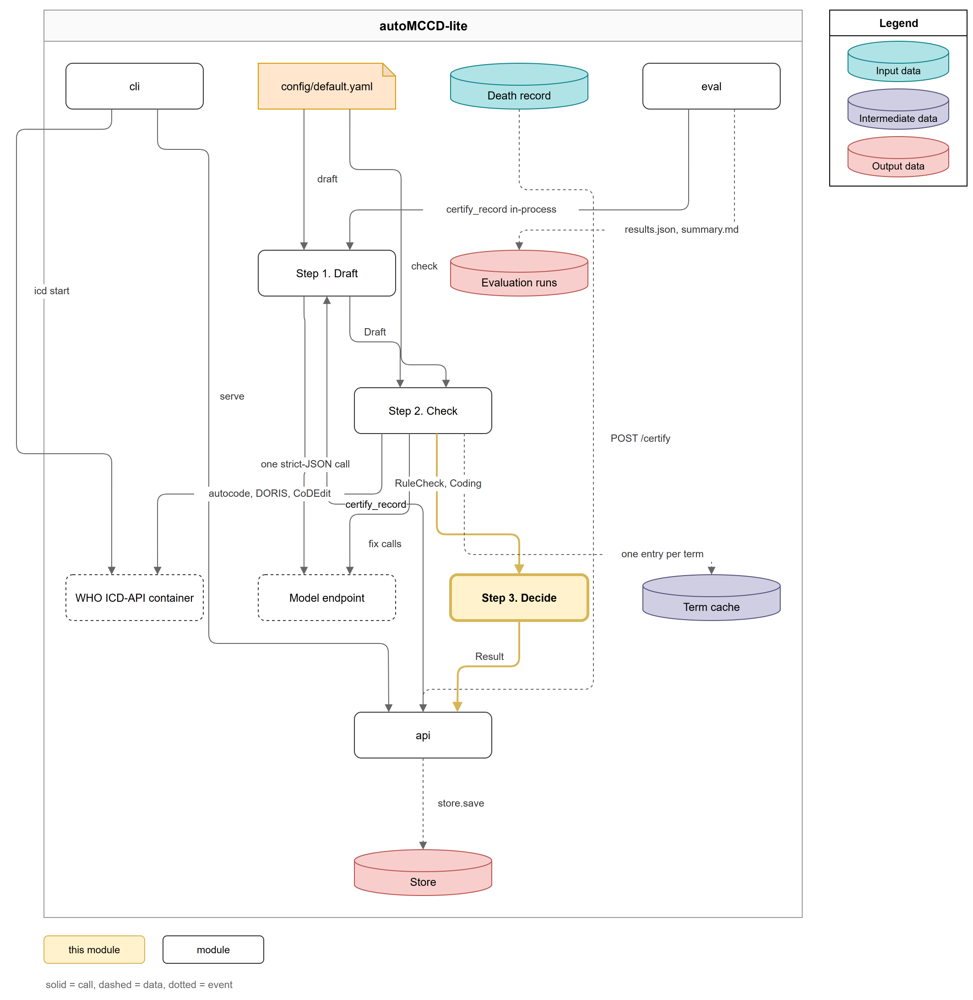
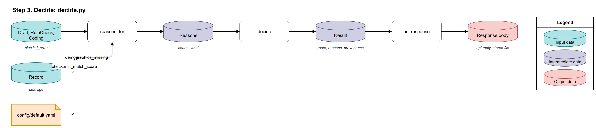
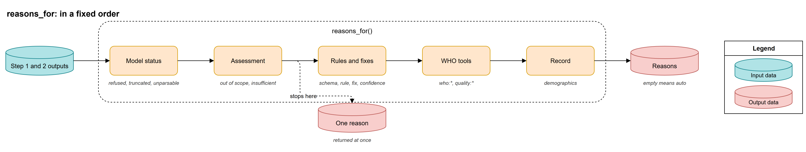
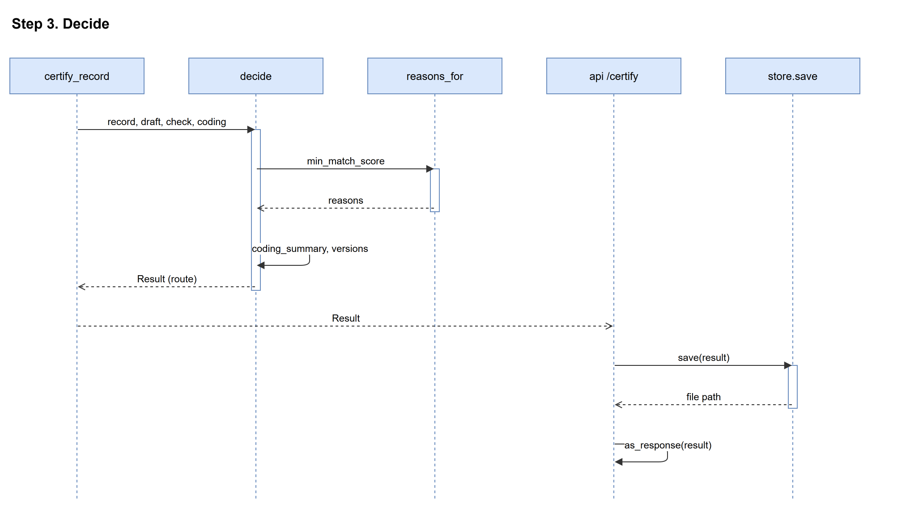

# Step 3. Decide

## Overview



The Decide step turns everything the first two steps found into a route and the reasons behind it. The router is a table, not a judgement: every situation that keeps a certificate from automatic acceptance leaves a stable reason code of the form `source:what`, so the response and the stored row both say why a human is looking at the certificate. No reasons means the route `auto`; any reason means `review`. A record the model declined is `review` with a `declined:*` reason, not a route of its own. The step writes nothing; the api saves the result afterwards.

The step runs in three parts:

1. **Collect the reasons**: `reasons_for` walks the draft, the rule check, the coding and the record in a fixed order and lists every reason that applies.
2. **Build the result**: `decide` sets the route from the reasons and packs everything the steps produced into one `Result`, with a coding summary and the versions block.
3. **Shape the response**: `as_response` drops the bulky provenance fields, which stay in the stored row.

You provide the draft, the rule check (`RuleCheck`), the coding (`Coding`) and the container error code from Step 2; the step produces a `Result` with the route and its reasons, and the response body the api returns and saves as a file.

## Inputs and Outputs

### Inputs

1. The record (a `Record`): the step reads only whether the sex or the age is missing (`src/automccd_lite/models.py:75`)
2. The draft (a `Draft`; see [Step 1. Draft](draft.md#outputs))
3. The rule check (a `RuleCheck`, or `None` when no certificate parsed; see [Step 2. Check](check.md#outputs))
4. The coding (a `Coding`, or `None` when nothing was coded)
5. The container error code, `who:unavailable`, `who:error` or `None` (`src/automccd_lite/pipeline.py:95`)
6. `config/default.yaml`, key `check.min_match_score` (see Quickstart)

### Outputs

1. The result (a `Result`, in memory; the api saves it whole as a row)

| Field | Type | Description | Source |
|---|---|---|---|
| `record_id` | `str` | The record's id. | `src/automccd_lite/models.py:177` |
| `route` | `auto` or `review` | Where the certificate goes next. | `src/automccd_lite/models.py:178` |
| `reasons` | `list[str]` | The reason codes, in the order of the table below. | `src/automccd_lite/models.py:179` |
| `certificate` | `dict` or `None` | The certificate after the fixes. | `src/automccd_lite/models.py:180` |
| `coding` | `CodingSummary` or `None` | The underlying cause (stem and full code), the codes, the match scores, the quality issue ids and the cause selector's warning. | `src/automccd_lite/decide.py:91` |
| `versions` | `Versions` | The prompt version and sha1, the schema version, the model, the ICD-11 release and the package version. | `src/automccd_lite/decide.py:104` |
| `usage`, `timings_ms` | `Usage`, `dict` | The tokens and calls of every model call; the milliseconds per step. | `src/automccd_lite/models.py:183` |
| `draft_status` | `str` | The final draft's status. | `src/automccd_lite/models.py:186` |
| `rule_check` | `RuleCheck` or `None` | The whole rule check, with what the fixes did. | `src/automccd_lite/models.py:187` |
| `who_replies` | `Coding` or `None` | The raw replies of the term coder (autocode), the cause selector (DORIS) and the quality checks (CoDEdit). | `src/automccd_lite/models.py:188` |
| `icd_error` | `str` or `None` | `who:unavailable` or `who:error`. | `src/automccd_lite/models.py:189` |

2. The response body (JSON): the `Result` without `rule_check`, `who_replies`, `icd_error` and `draft_status` (`src/automccd_lite/decide.py:145`). The api returns it, and the store writes it as the certificate's JSON file.

### Routes

| Route | When | Source |
|---|---|---|
| `auto` | No reason applies: the certificate may be accepted without a human. | `src/automccd_lite/decide.py:127` |
| `review` | At least one reason applies, including every declined record. | `src/automccd_lite/decide.py:127` |

### Reason Codes

`reasons_for` checks in a fixed order: the model, the assessment, the schema, the rules, the fixes, the confidence, the WHO tools, the record. The first five rows end the list at once, so such a result carries exactly one reason; every later row adds to the list.

| Reason | When | Source |
|---|---|---|
| `model:refused` | The model refused, or a content filter stopped the reply. The only reason. | `src/automccd_lite/decide.py:42` |
| `model:truncated` | The reply hit the token limit. The only reason. | `src/automccd_lite/decide.py:44` |
| `model:unparsable` | No rule check exists: the reply did not parse, and the rules fix gave no parsable certificate either. The only reason. | `src/automccd_lite/decide.py:46` |
| `declined:out_of_scope` | The model assessed the record as out of scope: an external cause, an undetermined manner of death, or a case for forensic expertise. The only reason. | `src/automccd_lite/decide.py:49` |
| `declined:insufficient` | The model assessed the record as insufficient information. The only reason. | `src/automccd_lite/decide.py:51` |
| `schema:invalid` | The certificate does not match the output schema. | `src/automccd_lite/decide.py:55` |
| `rule:1` | An evidence span is not copied word for word from the note it names, so the model may have invented the words that support a condition. | `src/automccd_lite/decide.py:56`, `src/automccd_lite/rules.py:158` |
| `rule:2` | A Part I line is a mode of dying, such as cardiac arrest, respiratory failure or old age, or line 1a is a bare "heart failure" or "shock" with no type named. A mode of dying says how the heart or lungs stopped, not the disease that caused it. | `src/automccd_lite/decide.py:56`, `src/automccd_lite/rules.py:159` |
| `rule:3` | A Part I term joins two conditions on one line, for example "meningitis and septicaemia". Each line must hold one condition. | `src/automccd_lite/decide.py:56`, `src/automccd_lite/rules.py:160` |
| `rule:4` | A term uses an abbreviation such as MI, CVA, COPD or CKD instead of the full name. HIV, AIDS and TB are allowed. | `src/automccd_lite/decide.py:56`, `src/automccd_lite/rules.py:161` |
| `rule:5` | Part I has an empty term, the same term twice, or six or more lines. | `src/automccd_lite/decide.py:56`, `src/automccd_lite/rules.py:162` |
| `rule:6` | A known interval gets shorter going down Part I, so a condition lower in the chain started after the condition it caused. | `src/automccd_lite/decide.py:56`, `src/automccd_lite/rules.py:163` |
| `rule:7` | A Part II term repeats a Part I term. A condition belongs in the chain or in the contributing conditions, not in both. | `src/automccd_lite/decide.py:56`, `src/automccd_lite/rules.py:164` |
| `rule:8` | The assessment and the chain disagree: a declined certificate still has a Part I chain or gives no decline reason, or a certifiable one has no chain or gives a decline reason. | `src/automccd_lite/decide.py:56`, `src/automccd_lite/rules.py:165` |
| `rule:9` | A certified term has an ICD-10 or ICD-11 code written into it. The WHO tools assign the codes, not the model. | `src/automccd_lite/decide.py:56`, `src/automccd_lite/rules.py:166` |
| `rule:10` | A term, an evidence span, `review.note` or `decline_reason` holds a phone number, an identity card number (NIC), an email or a street address. | `src/automccd_lite/decide.py:56`, `src/automccd_lite/rules.py:167` |
| `fix:rules` | The rules fix ran, whether its certificate was adopted or rejected. | `src/automccd_lite/decide.py:58` |
| `fix:terms` | The terms fix changed at least one Part I term. | `src/automccd_lite/decide.py:60` |
| `model:low_confidence` | The model's own confidence in `review.confidence` is not `high`. | `src/automccd_lite/decide.py:62` |
| `who:unavailable` | The WHO ICD-API container could not be reached during the terms fix or the coding. | `src/automccd_lite/decide.py:65`, `src/automccd_lite/pipeline.py:95` |
| `who:error` | The container answered with a 4xx, or with a 5xx after the retries. | `src/automccd_lite/decide.py:65`, `src/automccd_lite/pipeline.py:97` |
| `who:not_coded` | No container error and no coding: the assessment was not `certifiable`, so Step 2 coded nothing. | `src/automccd_lite/decide.py:67`, `src/automccd_lite/pipeline.py:85` |
| `who:line_uncoded` | At least one Part I line got no ICD-11 code. | `src/automccd_lite/decide.py:70` |
| `who:low_match` | At least one Part I match score is missing or under `check.min_match_score`. | `src/automccd_lite/decide.py:72` |
| `who:no_cause` | The cause selector (DORIS) returned no underlying cause. | `src/automccd_lite/decide.py:74` |
| `quality:<id>` | One per issue id the quality checks (CoDEdit) returned on the whole certificate or on the cause alone, without repeats, e.g. `quality:BER-CE-1`. The code names `FER-CE-931` (ill-defined cause), `FER-CE-873` and `FER-CE-874` (sex inconsistent) and `FER-CE-913` (age implausible). | `src/automccd_lite/decide.py:78`, `src/automccd_lite/coding.py:56` |
| `record:demographics_missing` | The record has no sex, or no age. | `src/automccd_lite/decide.py:81`, `src/automccd_lite/models.py:75` |

## Folder Structure

```
src/automccd_lite/
└── decide.py          # reasons_for, decide, coding_summary, versions, as_response
```

## Quickstart

:::{note}
Decide works on what Steps 1 and 2 produced. Run the [Step 2 Quickstart](check.md#quickstart) first, in the same Python interpreter, so `record`, `draft`, `check` and `coding` exist. When the certificate was declined, Step 2 coded nothing: set `coding = None`.
:::

### 1. Decide the route

```python
from automccd_lite.decide import decide, as_response

result = decide(record, draft, check, coding)  # src/automccd_lite/decide.py:114
print(result.route, result.reasons)
print(result.coding.underlying_cause if result.coding else None)
```

You should see `review` or `auto` and the list of reason codes, for example `review ['fix:rules', 'model:low_confidence', 'quality:BER-CE-1']`.

### 2. Look at the response body

```python
import json

print(json.dumps(as_response(result), indent=2))  # src/automccd_lite/decide.py:141
```

- The body has no `rule_check` or `who_replies`; read them on `result` itself.

:::{tip}
`certify_record` runs all three steps in one call and writes nothing: `certify_record(record, build_deps())` from `automccd_lite.pipeline` returns the same `Result` (`src/automccd_lite/pipeline.py:68`).
:::

### Configuration

| Key | Type | Default | Description | Source |
|---|---|---|---|---|
| `check.min_match_score` | `float` | `0.5` | A Part I match score under this adds `who:low_match`. | `src/automccd_lite/decide.py:124` |
| `draft.model` | `str` | `"gpt-5-nano-2025-08-07"` | Written to `versions.model` when the endpoint reported no model name. | `src/automccd_lite/decide.py:108` |
| `check.icd_release` | `str` | `"2026-01"` | Written to `versions.icd_release`. | `src/automccd_lite/decide.py:109` |

## Components



| Component | Lives in | Description |
|---|---|---|
| reasons_for | `src/automccd_lite/decide.py:31` | Lists every reason the certificate needs a human, in a fixed order. |
| decide | `src/automccd_lite/decide.py:114` | Sets the route and builds the `Result`. |
| as_response | `src/automccd_lite/decide.py:141` | Turns the `Result` into the api body. |

### reasons_for

The reason collector says, in stable codes, everything that keeps your certificate from automatic acceptance. A failure that leaves nothing to check further, such as a refused reply or a declined record, returns a single reason at once; otherwise every applicable reason is added in a fixed order, so the same situation always produces the same list.



#### Inputs and Outputs

- In: the record, the draft, the rule check, the coding, the container error code and the minimum match score (`src/automccd_lite/decide.py:31`)
- Out: the list of reason codes in the [Reason Codes](#reason-codes) table (`src/automccd_lite/decide.py:82`)

#### Configuration

| Name | Type | Default | Where read |
|---|---|---|---|
| `check.min_match_score` | `float` | `0.5` | `src/automccd_lite/decide.py:124` |

#### Things to Note

- `config/default.yaml` says Decide has no settings, yet the step reads `check.min_match_score` from the `check` section for `who:low_match`, the same threshold the terms fix uses (`config/default.yaml:1`, `src/automccd_lite/decide.py:124`).

### decide

The result builder sets the route and keeps everything the steps produced in one object, so a reviewer or an audit can see why the route came out as it did. The route is `review` when any reason exists and `auto` otherwise. Beside the route it builds the coding summary (`coding_summary`: the underlying cause as stem and full code, the codes, the match scores, the quality issue ids from both quality calls, and the cause selector's warning) and the versions block (`versions`: the prompt version and sha1, the schema version, the model, the ICD-11 release and the package version).

#### Inputs and Outputs

- In: the record, the draft, the rule check, the coding, the container error code and the timings (`src/automccd_lite/decide.py:114`)
- Out: a `Result` (`src/automccd_lite/decide.py:125`)

### as_response

The response shaper keeps the api body small: it drops the rule check, the raw WHO replies, the container error code and the draft status, which stay in the stored row.

#### Inputs and Outputs

- In: a `Result` (`src/automccd_lite/decide.py:141`)
- Out: a JSON-ready dict, returned by `POST /certify` and written as the certificate's file (`src/automccd_lite/api.py:88`, `src/automccd_lite/store.py:132`)

## Data Flow



1. `certify_record` calls `decide` with the record, the draft, the rule check, the coding, the container error code and the timings so far (`src/automccd_lite/pipeline.py:101`).
2. `decide` asks `reasons_for` for the reasons, with `check.min_match_score` from the config (`src/automccd_lite/decide.py:124`).
3. `decide` sets the route: `review` with any reason, `auto` with none (`src/automccd_lite/decide.py:127`).
4. `decide` adds the coding summary and the versions block and returns the `Result` (`src/automccd_lite/decide.py:130`).
5. `certify_record` stores the final timings on the result and returns it (`src/automccd_lite/pipeline.py:103`).
6. The api saves the result: the JSON file first, then the row that records its path, so a row never points at a missing file (`src/automccd_lite/api.py:75`, `src/automccd_lite/store.py:125`).
7. The api returns `as_response(result)` as the body of `POST /certify` (`src/automccd_lite/api.py:88`).
