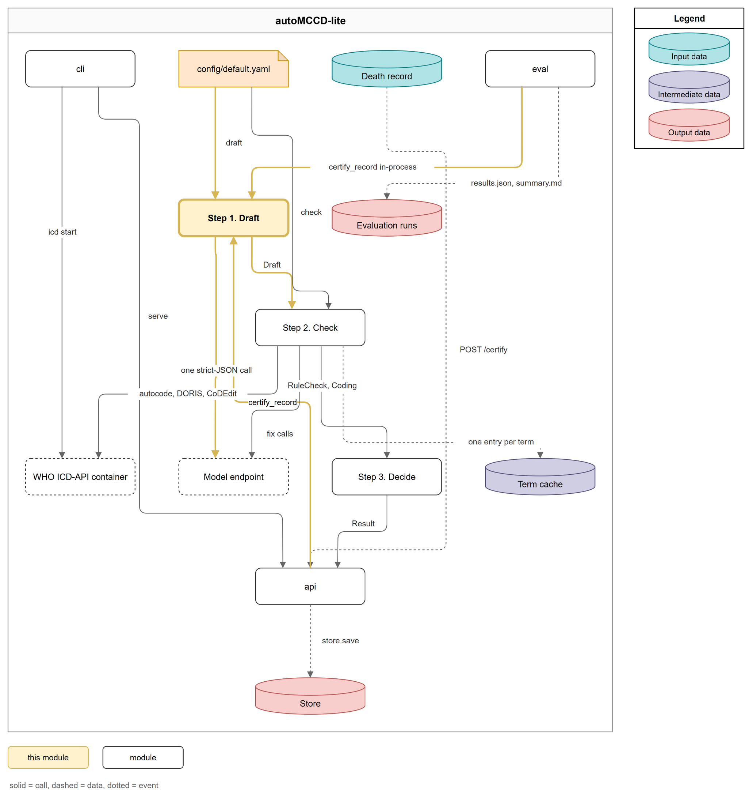
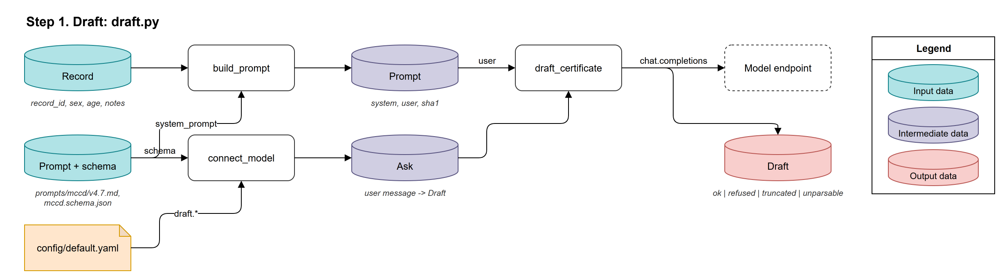
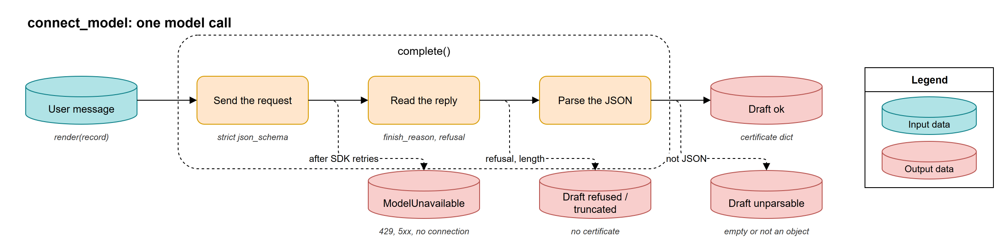
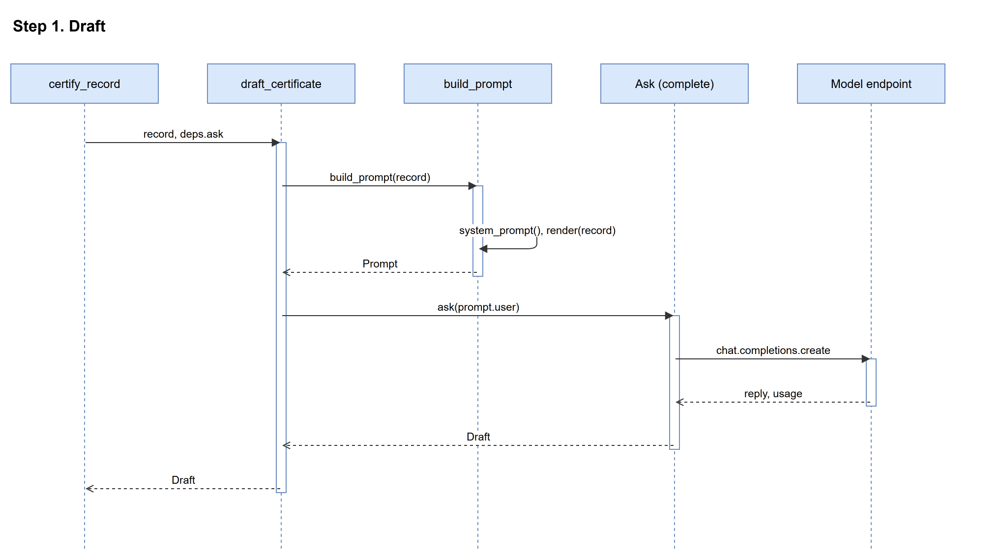

# Step 1. Draft

## Overview



The Draft step turns your death record into a first certificate, written by the model in one call. It shows the model your record's notes together with the prompt and the output schema, and asks for one JSON object in the shape of the WHO Medical Certificate of Cause of Death (MCCD): the chain of conditions in Part I, the contributing conditions in Part II, an evidence span for every condition, and a short review block with the model's confidence. The step never judges the certificate; that is the Check step's work. It only reports whether the model answered with a usable object.

The step runs in three parts:

1. **Build the prompt**: `build_prompt` assembles the fixed system prompt once and renders your record as the user message.
2. **Connect the model**: `connect_model` fixes the endpoint, the system prompt, the strict schema and the model settings, and leaves only the user message open.
3. **Draft the certificate**: `draft_certificate` sends the user message and turns the reply into a `Draft` with a status.

You provide one record with at least one note; the step produces a `Draft` whose status is `ok`, `refused`, `truncated` or `unparsable`, with the certificate when the reply parsed.

## Inputs and Outputs

### Inputs

1. The record (a `Record`, the body of `POST /certify`)

| Field | Type | Description | Source |
|---|---|---|---|
| `record_id` | `str` | The record's id; the model copies it into the certificate. | `src/automccd_lite/models.py:45` |
| `sex` | `"male"`, `"female"` or `None` | Shown to the model as `not recorded` when missing. | `src/automccd_lite/draft.py:87` |
| `age`, `age_unit` | `float`, unit or `None` | Shown to the model as an ISO-8601 duration, e.g. `P49Y`. | `src/automccd_lite/draft.py:88` |
| `registry_info` | `str` or `None` | Registry metadata, shown under a label that tells the model not to cite it. | `src/automccd_lite/draft.py:92` |
| `notes` | `list[Note]` | Each note is shown under `=== field: <name> ===`. | `src/automccd_lite/draft.py:95` |

2. `prompts/mccd/v4.7.md` (markdown, the prompt text; the version comes from `draft.prompt_version`)
3. `prompts/schemas/mccd.schema.json` (JSON Schema, the output contract the model must follow)
4. `config/default.yaml`, section `draft` (see Quickstart)

### Outputs

1. The draft (a `Draft`, in memory, handed to the Check step)

| Field | Type | Description | Source |
|---|---|---|---|
| `status` | `str` | `ok`, `refused`, `truncated` or `unparsable`. | `src/automccd_lite/models.py:102` |
| `certificate` | `dict` or `None` | The parsed JSON object; present only when the status is `ok`. | `src/automccd_lite/models.py:103` |
| `reason` | `str` or `None` | Why the reply was not usable, e.g. `finish_reason=length`. | `src/automccd_lite/models.py:104` |
| `model` | `str` or `None` | The model name the endpoint reported. | `src/automccd_lite/models.py:105` |
| `usage` | `Usage` | Prompt, completion and reasoning tokens, and the number of calls. | `src/automccd_lite/models.py:106` |
| `seconds` | `float` or `None` | The duration of the call. | `src/automccd_lite/models.py:107` |

2. The certificate inside the draft (JSON, the shape of `mccd.schema.json`)

| Field | Type | Description | Source |
|---|---|---|---|
| `record_id` | `str` | The record id, copied verbatim. | `prompts/schemas/mccd.schema.json:10` |
| `assessment` | `str` | `certifiable`, `insufficient_information` or `out_of_scope`. | `prompts/schemas/mccd.schema.json:14` |
| `decline_reason` | `str` or `null` | Set only when the assessment is not `certifiable`. | `prompts/schemas/mccd.schema.json:19` |
| `part1` | `list[condition]` | The chain, line 1a first. | `prompts/schemas/mccd.schema.json:26` |
| `part2` | `list[condition]` | The other significant conditions. | `prompts/schemas/mccd.schema.json:31` |
| `{part1,part2}[].{certified_term, evidence_field, evidence_span, basis, interval}` | per condition | The term, the note it came from, the quoted evidence span, how it was established, the onset-to-death interval. | `prompts/schemas/mccd.schema.json:42` |
| `review.{confidence, flags, note}` | object | The model's confidence (`high`, `moderate`, `low`), review flags and one sentence for the reviewer. | `prompts/schemas/mccd.schema.json:95` |

## Folder Structure

```
src/automccd_lite/
└── draft.py                     # build_prompt, system_prompt, connect_model, draft_certificate
prompts/
├── mccd/v4.7.md                 # the prompt text
└── schemas/mccd.schema.json     # the strict output schema
config/
└── default.yaml                 # the draft section
```

## Quickstart

:::{note}
The Draft step needs only a model endpoint: fill `OPENAI_BASE_URL` and `OPENAI_API_KEY` in `.env` first. Run the code from the repository root, so the relative path to `data/examples/S01.json` resolves.
:::

### 1. Load an example record

- `data/examples/S01.json` holds one record in the `POST /certify` shape, with a single `case_narrative` note.

### 2. Look at what the model sees

- `build_prompt` returns the system prompt, the user message and the system prompt's sha1, the hash that identifies the prompt in every result.

### 3. Ask the model for a draft

Start `uv run python` in the repository root and run:

```python
import json
from automccd_lite.models import Record
from automccd_lite.draft import build_prompt, connect_model, draft_certificate

record = Record(**json.load(open("data/examples/S01.json", encoding="utf-8")))
prompt = build_prompt(record)  # src/automccd_lite/draft.py:109
print(prompt.user)  # the record as the model reads it
print(prompt.sha1)

ask = connect_model()  # src/automccd_lite/draft.py:195
draft = draft_certificate(record, ask)  # src/automccd_lite/draft.py:210
print(draft.status, draft.usage)
print(json.dumps(draft.certificate, indent=2))
```

You should see the status `ok` and a certificate with an `assessment`, a Part I chain and a `review` block. A second run gives a different certificate more often than not, because the model is not deterministic.

### Configuration

| Key | Type | Default | Description | Source |
|---|---|---|---|---|
| `draft.prompt_version` | `str` | `"4.7"` | Picks `prompts/mccd/v<version>.md`. | `config/default.yaml:5` |
| `draft.schema` | `str` | `"mccd"` | Picks `prompts/schemas/<schema>.schema.json`. | `config/default.yaml:6` |
| `draft.model` | `str` | `"gpt-5-nano-2025-08-07"` | The model name sent to the endpoint. | `config/default.yaml:7` |
| `draft.temperature` | `float` or `null` | `null` | `null` means the field is not sent, because reasoning models reject anything but the default. | `config/default.yaml:8` |
| `draft.seed` | `int` | `20251023` | Sent as the seed; best effort only. | `config/default.yaml:9` |
| `draft.reasoning_effort` | `str` | `minimal` | `minimal` spends no reasoning tokens and answers in about 3 s. | `config/default.yaml:10` |
| `draft.max_completion_tokens` | `int` | `8000` | Must cover the hidden reasoning tokens as well as the answer. | `config/default.yaml:11` |
| `draft.timeout_s` | `float` | `120` | The timeout of one call. | `config/default.yaml:12` |
| `draft.max_retries` | `int` | `4` | The SDK's own retries on 429 and 5xx. | `config/default.yaml:13` |
| `OPENAI_BASE_URL` | env | `https://api.openai.com/v1` in `.env.example` | The OpenAI-compatible endpoint. | `src/automccd_lite/config.py:78` |
| `OPENAI_API_KEY` | env | none | The key for that endpoint. | `src/automccd_lite/config.py:79` |
| `LLM_MODEL` | env | unset | Overrides `draft.model` when set. | `src/automccd_lite/config.py:75` |

## Components



| Component | Lives in | Description |
|---|---|---|
| build_prompt | `src/automccd_lite/draft.py:109` | Turns your record into the user message, beside the fixed system prompt. |
| connect_model | `src/automccd_lite/draft.py:195` | Builds the one model call that every request in the pipeline goes through. |
| draft_certificate | `src/automccd_lite/draft.py:210` | Sends your rendered record and returns the reply as a `Draft`. |

### build_prompt

The prompt builder shows the model the same fixed instructions for every record and your record in a fixed layout. The system prompt is the prompt file, the output schema and a one-line reply rule, assembled once (`system_prompt`, `assemble`); the user message is your record rendered as text (`render`). Because the assembly is fixed to the byte, its sha1 identifies the prompt in every result's versions block.

#### Inputs and Outputs

- In: a `Record` (`src/automccd_lite/draft.py:109`), the prompt file and the schema file (`src/automccd_lite/draft.py:70`)
- Out: a `Prompt` with `system`, `user` and `sha1` (`src/automccd_lite/draft.py:103`)

#### Configuration

| Name | Type | Default | Where read |
|---|---|---|---|
| `draft.prompt_version` | `str` | `"4.7"` | `src/automccd_lite/draft.py:70` |
| `draft.schema` | `str` | `"mccd"` | `src/automccd_lite/draft.py:71` |

### connect_model

The model connector makes every call in the pipeline go through one function with the same system prompt and the same strict schema, so the first draft and both fixes in the Check step get replies of the same shape. It creates the OpenAI client from your `.env`, fixes the system prompt, the schema and the `draft` settings, and returns an `Ask`: a function from a user message to a `Draft` (`complete`). The request asks for a strict `json_schema` response, so the endpoint constrains the reply to the schema.



#### Inputs and Outputs

| Direction | What | Source |
|---|---|---|
| In | The `draft` settings and the endpoint and key from `.env` | `src/automccd_lite/draft.py:199` |
| Out | An `Ask`: user message in, `Draft` out | `src/automccd_lite/draft.py:117` |
| Out | `ModelUnavailable` when a 429, a 5xx or a lost connection outlasts the SDK's retries; the api answers 503 and saves nothing | `src/automccd_lite/draft.py:157` |
| Out | `refused` on a refusal or a content filter, `truncated` when the reply hit the token limit | `src/automccd_lite/draft.py:178` |
| Out | `unparsable` on an empty reply, invalid JSON, or JSON that is not an object | `src/automccd_lite/draft.py:184` |

#### Configuration

| Name | Type | Default | Where read |
|---|---|---|---|
| `draft.model` | `str` | `"gpt-5-nano-2025-08-07"` | `src/automccd_lite/draft.py:137` |
| `draft.max_completion_tokens` | `int` | `8000` | `src/automccd_lite/draft.py:143` |
| `draft.temperature` | `float` or `null` | `null` | `src/automccd_lite/draft.py:147` |
| `draft.seed` | `int` | `20251023` | `src/automccd_lite/draft.py:149` |
| `draft.reasoning_effort` | `str` | `minimal` | `src/automccd_lite/draft.py:151` |
| `draft.max_retries`, `draft.timeout_s` | `int`, `float` | `4`, `120` | `src/automccd_lite/draft.py:203` |
| `OPENAI_BASE_URL`, `OPENAI_API_KEY` | env | see Quickstart | `src/automccd_lite/draft.py:201` |

#### Things to Note

- A `null` in `draft.temperature` or `draft.reasoning_effort` leaves the field out of the request instead of sending `null`, so the same code serves reasoning and non-reasoning models (`src/automccd_lite/draft.py:147`).
- The seed is sent on every call, yet two runs of the same record still differ: the configured model is not deterministic (`config/default.yaml:9`).

### draft_certificate

The drafting call is the whole of Step 1 from the pipeline's side: your rendered record goes to the model once, and the reply comes back as a `Draft`.

#### Inputs and Outputs

- In: a `Record` and an `Ask` (`src/automccd_lite/draft.py:210`)
- Out: a `Draft` (`src/automccd_lite/draft.py:211`)

## Data Flow



1. `certify_record` calls `draft_certificate` with your record and the pipeline's `Ask` (`src/automccd_lite/pipeline.py:73`).
2. `build_prompt` takes the system prompt and renders your record as the user message (`src/automccd_lite/draft.py:110`).
3. `system_prompt` reads the prompt file and the schema once, assembles them with the reply rule, and hashes the result (`src/automccd_lite/draft.py:67`).
4. `render` writes the record id, the sex and age, the registry information under its do-not-cite label, and each note under its field name (`src/automccd_lite/draft.py:85`).
5. The `Ask` sends the system prompt and the user message with the strict schema as the response format (`src/automccd_lite/draft.py:136`).
6. `complete` turns the reply into a `Draft` with the status `ok`, `refused`, `truncated` or `unparsable` (`src/automccd_lite/draft.py:175`).
7. `certify_record` sends the draft on to the Check step only when its status is `ok` or `unparsable`; a refused or truncated draft goes straight to Step 3 (`src/automccd_lite/pipeline.py:80`).
