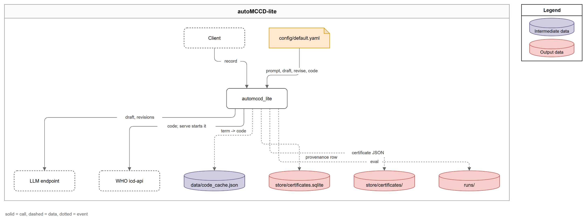

# autoMCCD-lite

The answer key for the MCCD proof of concept. Clinical record text goes in; a WHO Medical
Certificate of Cause of Death (MCCD) coded in ICD-11 comes out, with a route (`auto` or `review`)
and the reason codes behind it.

```
build_prompt -> draft_certificate -> validate_draft -> revise_draft
             -> code_draft (with revise_terms inside) -> route_draft -> generate_certificate
```

One module per stage under `src/automccd_lite/`; `pipeline.py` calls them in order. The model
proposes a certificate, the code checks it against ten rules and the WHO's own coding tools, and
only a certificate that passes everything may skip the human.

## Sections

::::{grid} 1 1 2 2
:gutter: 2

:::{grid-item-card} automccd_lite
:link: automccd_lite
:link-type: doc

The package turns one clinical record into a WHO Medical Certificate of Cause of Death coded in ICD-11, and tells you whether a human must look at it before it counts.
:::

:::{grid-item-card} API reference
:link: reference/api
:link-type: doc

The code reference, generated from the docstrings.
:::
::::

## Architecture



The package is the whole system: it takes your record from the api request, asks the model endpoint for a draft and for at most two revisions, codes the result through the WHO icd-api container, and hands the certificate to Blob storage and to the `certificates` table in Postgres. The autocode cache on disk saves a container call for every term it has seen; the evaluation harness writes its runs beside it. The [module guide](automccd_lite.md) walks through every stage.

## Data

| Path | Description | Source |
|---|---|---|
| `certificates/{yyyy-mm-dd}/{hhmmss}Z_{record_id}.json` | The response body of each certified record, in the blob container. | `src/automccd_lite/storage.py:22` |
| table `certificates` | One provenance row per certified record. | `src/automccd_lite/db.py:30` |
| `data/code_cache.json` | The autocode cache, `{term_key: entry}`, tracked in git. | `src/automccd_lite/code.py:51` |
| `runs/{set}_{hhmmss}Z/` | `results.json` and `summary.md` of one evaluation run. | `src/automccd_lite/eval.py:462` |

## Source code

```
autoMCCD-lite/
├── claude/lite/          # DECISIONS.md and PLAN.md, the design record
├── config/default.yaml   # tuning by stage
├── data/                 # gold, scenarios, sets, 3 records, robust_sample.json, code_cache.json
├── docker/               # compose.yml and the api Dockerfile
├── docs/                 # this site
├── notebooks/            # how-to-guide.ipynb, mccd_guide.ipynb, _helpers.py
├── prompts/              # mccd/v4.7.md, schemas/mccd.schema.json
├── scripts/              # smoke_test.sh
├── src/automccd_lite/    # the package, one module per stage
└── tests/                # test_validate, test_route, test_gold
```

| Module | Purpose | Doc | Generated from |
|---|---|---|---|
| automccd_lite | The package turns one clinical record into a WHO Medical Certificate of Cause of Death coded in ICD-11, and tells you whether a human must look at it before it counts. | [automccd_lite.md](automccd_lite.md) | `df3b472` |

```{toctree}
:caption: Modules
:hidden:

automccd_lite
```

```{toctree}
:caption: Reference
:hidden:

reference/api
```

Refresh with `/docs update`.
