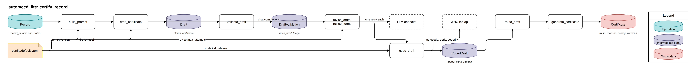
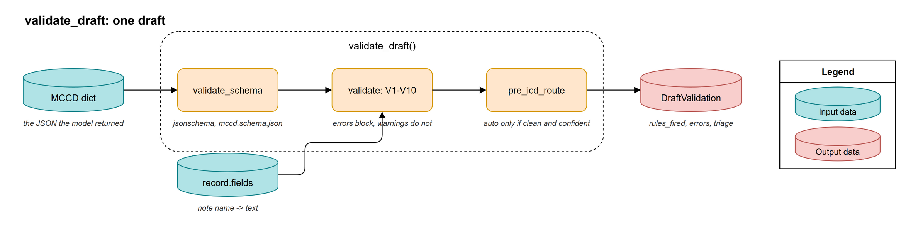
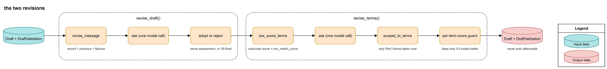
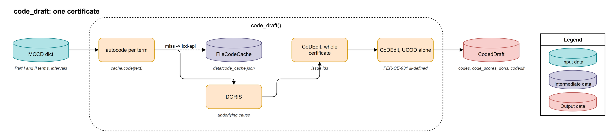

# Pipeline

One record goes through four nodes, in this order, and comes out as a certificate with a route. This page is the node-by-node account; the [module guide](automccd_lite.md) covers the inputs, the outputs, the settings and the supporting modules.

`certify_record` runs the four nodes in order, with a timer per stage, and hands each one what the previous one produced. The collaborators come in through `Deps`, so the same function runs with the real model and coder in the api and with fakes in the tests (`src/automccd_lite/pipeline.py:45`).

| Node | Made of | Description |
|---|---|---|
| Draft the MCCD | `src/automccd_lite/prompt.py:89`, `src/automccd_lite/draft.py:125` | The record becomes a prompt; the model returns a draft under the strict schema. |
| Verify | `src/automccd_lite/validate.py:569`, `src/automccd_lite/revise.py:74` | The ten rules, and one bounded revision when they fail. |
| Code | `src/automccd_lite/code.py:257`, `src/automccd_lite/revise.py:171` | The WHO tools, with one bounded terminology revision inside. |
| Generate the MCCD | `src/automccd_lite/route.py:14`, `src/automccd_lite/certificate.py:62` | The reason codes, the route, the certificate and where it goes. |

## Draft the MCCD

Your record becomes the text the model sees, and one model call returns a draft certificate whose shape is right by construction. The system prompt is the prompt file, the output schema and one reply rule, joined once at import and hashed; the hash goes into every certificate, so results from different prompts never mix. The user message is the record rendered as plain text, one block per note.

The model call is the only function in the package that talks to the model, and both revisions reuse it with a different user message. It turns the reply into a `Draft` whose status says what came back: `ok`, `refused`, `truncated` or `invalid`. It never raises on what the model said; it raises `ModelUnavailable` only when the service could not be reached after the SDK's retries, so the api can answer 503 and store nothing.

### Inputs and Outputs

- In: a `Record`; `prompts/mccd/v<version>.md` and `prompts/schemas/<schema>.schema.json` read once (`src/automccd_lite/prompt.py:48`)
- Out: a `Prompt` with `system`, `user` and `sha1` (`src/automccd_lite/prompt.py:89`), then a `Draft` with the status, the parsed certificate, the model name, the usage and the seconds (`src/automccd_lite/draft.py:55`)

### Configuration

| Name | Type | Default | Where read |
|---|---|---|---|
| `prompt.version`, `prompt.schema` | str | `"4.7"`, `"mccd"` | `src/automccd_lite/prompt.py:49` |
| `draft.temperature`, `draft.seed`, `draft.reasoning_effort` | optional | `null`, `20251023`, `minimal` | `src/automccd_lite/draft.py:69` |
| `draft.max_completion_tokens` | int | `8000` | `src/automccd_lite/draft.py:65` |

### Things to Note

- `temperature` and `reasoning_effort` are sent only when set, because a reasoning model rejects the first and a non-reasoning model rejects the second; the config leaves `temperature` null for the default model (`src/automccd_lite/draft.py:69`).

## Verify

The deterministic gate, and one second chance. The gate checks the schema again (a cheap defence against an endpoint that does not enforce strict mode) and runs the rules V1 to V10 against the text of your notes: verbatim evidence spans, no modes of dying, one cause per line, no abbreviations, structure, non-decreasing intervals, Part II disjoint from Part I, decline consistency, no ICD codes in terms, no personal identifiers. Errors block; warnings are recorded for the reviewer. It also gives the gate's own opinion of the route, which the router may only tighten.

When a rule fails, the revision sends the model its own draft with the list of failures and asks for a corrected certificate, once. The answer is adopted only if it still answers the same question: it parses, and it keeps the same assessment, unless the first draft broke the decline rule itself. Adopted or rejected, a draft that needed a revision never routes `auto`.

### Inputs and Outputs

- In: the MCCD dict and `record.fields`, the note name to text map (`src/automccd_lite/validate.py:569`)
- Out: a `DraftValidation` with `schema_ok`, `validator_passed`, `rules_fired`, `errors`, `warnings`, the model's `assessment` and `confidence`, and `triage` (`src/automccd_lite/validate.py:577`)
- Revision in: the `Draft`, its `DraftValidation`, the record and the model call (`src/automccd_lite/revise.py:74`)
- Revision out: the draft and validation the pipeline goes on with, with `revised` or `revise_rejected` set; the returned draft's usage includes the revision call (`src/automccd_lite/revise.py:102`)

### Configuration

| Name | Type | Default | Where read |
|---|---|---|---|
| `revise.max_attempts` | int | `1` | `src/automccd_lite/pipeline.py:61` |

### Things to Note

- V2 fires on a mode of dying on any Part I line, but the bare "shock" and "heart failure" check runs on line 1a only; "congestive heart failure" on 1a is allowed, because the S17 gold certificate writes it there (`src/automccd_lite/validate.py:69`).
- A five-line Part I is a warning, not an error: the WHO form has four lines but DORIS accepts five, and the S14 gold uses all five (`src/automccd_lite/validate.py:315`).
- `never_auto` tightens the triage after any revision, and the router adds `revised` (`src/automccd_lite/validate.py:593`).

## Code

The certificate goes to the WHO's own tools, and a term the coder cannot match gets one chance to be restated. The client talks to the self-hosted icd-api container: autocode turns each written term into an ICD-11 code with a match score, DORIS selects the underlying cause from the coded chain, and CoDEdit runs the quality checks. CoDEdit runs twice because a validity error on the whole certificate suppresses its clinical checks; the second call sends the selected underlying cause alone, so the ill-defined check (`FER-CE-931`) is always asked.

Every term is coded once and cached in `data/code_cache.json`, with its matched text and score for audit. Autocode error is indistinguishable from model error, so a stable code per term keeps runs comparable.

The terminology revision runs before coding when a Part I term scores under `code.min_match_score`. It asks the model once to restate the listed terms as the standard ICD-11 name of the same condition and nothing else. Only its Part I terms are taken over, and each restated term is kept only if it codes with a higher score than the original: a revision may not make coding worse.

### Inputs and Outputs

- In: the MCCD dict, the demographics (`sex`, `age_iso`), the cache and the client (`src/automccd_lite/code.py:257`)
- Out: a `CodedDraft` with the codes per line, the match scores, the DORIS reply and both CoDEdit replies (`src/automccd_lite/code.py:272`)
- Terminology revision in: the `Draft`, its `DraftValidation`, the cache, the model call and `code.min_match_score` (`src/automccd_lite/revise.py:171`)
- Terminology revision out: the draft and validation with `term_revision`, `term_changes` and `term_reverted` set (`src/automccd_lite/revise.py:233`)
- Side output: `data/code_cache.json`, rewritten on every new term (`src/automccd_lite/code.py:221`)

### Configuration

| Name | Type | Default | Where read |
|---|---|---|---|
| `ICD_API_URL` | env | `http://localhost:8082` | `src/automccd_lite/api.py:45` |
| `code.icd_release`, `code.linearization` | str | `"2026-01"`, `"mms"` | `src/automccd_lite/code.py:89` |
| `code.min_match_score` | float | `0.5` | `src/automccd_lite/pipeline.py:68` |
| `revise.term_max_attempts` | int | `1` | `src/automccd_lite/pipeline.py:67` |

### Things to Note

- The cache file is shared by the api, the harness and the notebooks; a save re-reads the file and merges before it rewrites, so no writer drops another's entries (`src/automccd_lite/code.py:221`).
- All three request headers are required: without `Accept` the container answers 412, without `API-Version` 400 (`src/automccd_lite/code.py:42`).
- Coding runs only when the assessment is `certifiable`; a declined record skips the WHO calls and routes to review on its assessment alone (`src/automccd_lite/pipeline.py:65`).

## Generate the MCCD

The decision and the certificate that carries it. The router is a table, not a judgement: every finding becomes a stable reason code, no reasons means `auto`, any reason means `review`. There is no score and no threshold, which is why a reviewer can trust that `auto` means every check passed. The reasons come in a fixed order: model status, assessment, schema, rules, revisions, confidence, coding, demographics.

The generator builds the `Certificate` from everything the nodes produced and, when the api passes a storage and a store, writes the JSON file first and then the SQLite row. The response body is the certificate without the provenance: the validation, the raw coding replies, the icd error and the draft status stay in the row.

### Inputs and Outputs

- In: the record, the draft, the validation, the coded draft, the icd error and `code.min_match_score` (`src/automccd_lite/route.py:14`)
- Out: a `Decision` with the route and the reasons (`src/automccd_lite/route.py:64`)
- Generator in: the decision, the usage, the timings, and optionally a `FileStorage` and a `SqliteCertificateStore` (`src/automccd_lite/certificate.py:62`)
- Generator out: a `Certificate`; the response body excludes `validation`, `coded`, `icd_error` and `draft_status` (`src/automccd_lite/certificate.py:97`)

### Things to Note

- A declined record is `review` with the single reason `assessment:out_of_scope` or `assessment:insufficient`, where the full autoMCCD gives it a route of its own (`src/automccd_lite/route.py:29`).
- A record without sex or age routes to review with `demographics_missing` even when every other check is clean, because DORIS needs both for its checks (`src/automccd_lite/route.py:61`).

