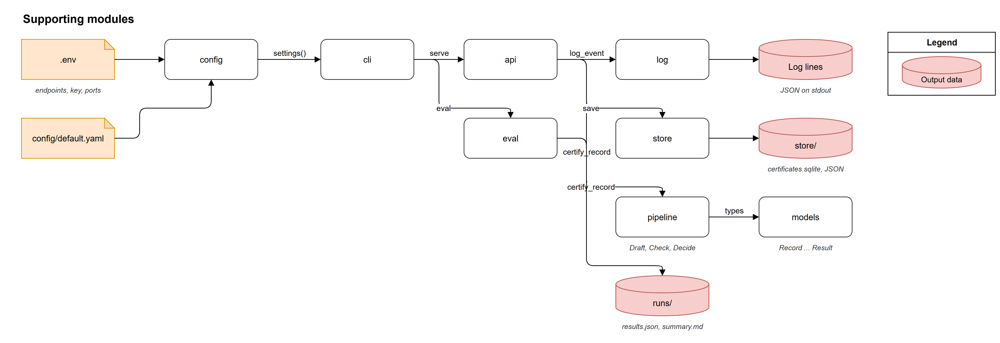

# Supporting Modules

## Overview

The supporting modules carry your record into the three steps and the result out of them: the api takes the request and saves the result, the store keeps it as a file and a row, the configuration module merges the settings file with your environment file, the log module writes structured lines without patient text, the command line tool starts everything, and the evaluation harness runs whole case sets. The three steps themselves are on their own pages: [Step 1. Draft](draft.md), [Step 2. Check](check.md) and [Step 3. Decide](decide.md).

You send a record to `POST /certify`; you get back the response body, and the store keeps a JSON file and a SQLite row for it.

## Request and Response

### The Request

The body of `POST /certify` is one record (a `Record`).

| Field | Type | Description | Source |
|---|---|---|---|
| `record_id` | `str`, at least one character | The record's id. | `src/automccd_lite/models.py:45` |
| `sex` | `"male"`, `"female"` or `null` | Optional; a missing sex routes the certificate to review. | `src/automccd_lite/models.py:46` |
| `age` | `float` (0 or more) or `null` | Optional; given together with `age_unit`. | `src/automccd_lite/models.py:47` |
| `age_unit` | `minutes`, `hours`, `days`, `weeks`, `months`, `years` or `null` | Optional; given together with `age`. | `src/automccd_lite/models.py:48` |
| `registry_info` | `str` or `null` | Registry metadata, shown to the model but never evidence. | `src/automccd_lite/models.py:49` |
| `notes` | list of `{name, text}`, at least one | The record text; note names must be unique. | `src/automccd_lite/models.py:50` |
| `notes[].name` | `str`, at least one character | The note's name, e.g. `case_narrative`. | `src/automccd_lite/models.py:37` |
| `notes[].text` | `str` | The note's text. | `src/automccd_lite/models.py:38` |

A record with repeated note names, or with only one of `age` and `age_unit`, fails validation (`src/automccd_lite/models.py:52`).

### The Response

The response body is the `Result` without its provenance fields (`src/automccd_lite/decide.py:145`).

| Field | Type | Description | Source |
|---|---|---|---|
| `record_id` | `str` | The record's id. | `src/automccd_lite/models.py:177` |
| `route` | `auto` or `review` | Where the certificate goes next. | `src/automccd_lite/models.py:178` |
| `reasons` | `list[str]` | The reason codes; see [Step 3. Decide](decide.md#reason-codes). | `src/automccd_lite/models.py:179` |
| `certificate` | object or `null` | The certificate in the shape of `prompts/schemas/mccd.schema.json`. | `src/automccd_lite/models.py:180` |
| `coding.underlying_cause` | `str` or `null` | The stem code of the underlying cause of death (UCOD). | `src/automccd_lite/models.py:156` |
| `coding.underlying_cause_full` | `str` or `null` | The full code of the underlying cause. | `src/automccd_lite/models.py:157` |
| `coding.codes` | `{part1, part2}` | One ICD-11 code per term. | `src/automccd_lite/models.py:158` |
| `coding.match_scores` | `list` | The match score of each Part I term. | `src/automccd_lite/models.py:159` |
| `coding.quality_issues` | `list[str]` | The quality check (CoDEdit) issue ids. | `src/automccd_lite/models.py:160` |
| `coding.cause_warning` | `str` or `null` | The cause selector's (DORIS) warning. | `src/automccd_lite/models.py:161` |
| `versions.{prompt_version, prompt_sha1, schema_version, model, icd_release, package_version}` | `str` | What produced the certificate. | `src/automccd_lite/models.py:165` |
| `usage.{prompt_tokens, completion_tokens, reasoning_tokens, calls}` | `int` | The tokens and calls of every model call for this record. | `src/automccd_lite/models.py:80` |
| `timings_ms` | `{draft, check, decide}` | Milliseconds per step. | `src/automccd_lite/pipeline.py:74` |

### The Stored Row

`store/certificates.sqlite`, table `certificates`, one row per certified record.

| Column | Type | Description | Source |
|---|---|---|---|
| `id` | integer | The row number, printed by `example` after `Saved:`. | `src/automccd_lite/store.py:68` |
| `record_id` | string, indexed | The record's id. | `src/automccd_lite/store.py:69` |
| `created_at` | timestamp | When the row was written. | `src/automccd_lite/store.py:70` |
| `route` | string | `auto` or `review`. | `src/automccd_lite/store.py:73` |
| `reasons` | JSON | The reason codes. | `src/automccd_lite/store.py:74` |
| `draft_status` | string | `ok`, `refused`, `truncated` or `unparsable`. | `src/automccd_lite/store.py:75` |
| `versions` | JSON | The versions block. | `src/automccd_lite/store.py:76` |
| `certificate` | JSON | The certificate; contains patient text. | `src/automccd_lite/store.py:77` |
| `coding` | JSON | The coding summary the response carries. | `src/automccd_lite/store.py:78` |
| `rule_check` | JSON | The rule check and what the fixes did; contains patient text. | `src/automccd_lite/store.py:79` |
| `who_replies` | JSON | The raw replies of the term coder (autocode), the cause selector (DORIS) and the quality checks (CoDEdit). | `src/automccd_lite/store.py:80` |
| `icd_error` | string | `who:unavailable` or `who:error`. | `src/automccd_lite/store.py:81` |
| `usage` | JSON | Tokens and calls. | `src/automccd_lite/store.py:82` |
| `timings_ms` | JSON | Milliseconds per step. | `src/automccd_lite/store.py:83` |
| `file_path` | string | The JSON file of this row, relative to the `store/` folder. | `src/automccd_lite/store.py:84` |

### The Stored File

`store/certificates/{yyyy-mm-dd}/{hhmmss}Z_{record_id}.json` holds the response body, the same JSON the api returned (`src/automccd_lite/store.py:132`). The UTC time prefix means a rerun of the same record never overwrites the first file (`src/automccd_lite/store.py:45`). The file is written before the row that records its path, so a row never points at a missing file (`src/automccd_lite/store.py:125`).

## Configuration

Tuning lives in `config/default.yaml`, one section per step that has settings; endpoints and secrets come only from the environment, so no secret is written to a file the package owns. `.env` in the repository root is loaded before the environment is read (`src/automccd_lite/config.py:73`).

| Key | Type | Default | Description | Source |
|---|---|---|---|---|
| `draft.prompt_version` | `str` | `"4.7"` | Picks `prompts/mccd/v<version>.md`. | `config/default.yaml:5` |
| `draft.schema` | `str` | `"mccd"` | Picks `prompts/schemas/<schema>.schema.json`. | `config/default.yaml:6` |
| `draft.model` | `str` | `"gpt-5-nano-2025-08-07"` | The model name; `LLM_MODEL` overrides it. | `config/default.yaml:7` |
| `draft.temperature` | `float` or `null` | `null` | Not sent when `null`. | `config/default.yaml:8` |
| `draft.seed` | `int` | `20251023` | Best effort; the model is not deterministic. | `config/default.yaml:9` |
| `draft.reasoning_effort` | `str` | `minimal` | Not sent when `null`. | `config/default.yaml:10` |
| `draft.max_completion_tokens` | `int` | `8000` | Covers the hidden reasoning tokens and the answer. | `config/default.yaml:11` |
| `draft.timeout_s` | `float` | `120` | The timeout of one model call. | `config/default.yaml:12` |
| `draft.max_retries` | `int` | `4` | The SDK's retries on 429 and 5xx. | `config/default.yaml:13` |
| `check.fix_rules_attempts` | `int` | `1` | `0` turns the rules fix off. | `config/default.yaml:16` |
| `check.fix_terms_attempts` | `int` | `1` | `0` turns the terms fix off. | `config/default.yaml:17` |
| `check.min_match_score` | `float` | `0.5` | Below this a match is weak: the terms fix and `who:low_match`. | `config/default.yaml:18` |
| `check.icd_release` | `str` | `"2026-01"` | Must match the release the container image serves. | `config/default.yaml:19` |
| `check.linearization` | `str` | `"mms"` | The ICD-11 linearization. | `config/default.yaml:20` |
| `check.timeout_s` | `float` | `30` | The timeout of one container call. | `config/default.yaml:21` |
| `check.max_retries` | `int` | `2` | Retries on a transport error or a 5xx. | `config/default.yaml:22` |
| `OPENAI_BASE_URL` | env | `https://api.openai.com/v1` in `.env.example` | The OpenAI-compatible model endpoint. | `src/automccd_lite/config.py:78` |
| `OPENAI_API_KEY` | env | none | The model key; `serve` stops while it is empty. | `src/automccd_lite/config.py:79` |
| `LLM_MODEL` | env | unset | Overrides `draft.model`. | `src/automccd_lite/config.py:75` |
| `ICD_API_URL` | env | `http://localhost:8082` | Where the api, the eval and the notebooks reach the container. | `src/automccd_lite/config.py:80` |
| `STORE_DIR` | env | `<repo>/store` | The folder of the SQLite file and the JSON files. | `src/automccd_lite/config.py:81` |
| `API_PORT` | env | `8000` | The port the api listens on. | `src/automccd_lite/config.py:82` |
| `API_HOST` | env | `127.0.0.1` | The address the api listens on. | `src/automccd_lite/cli.py:147` |
| `ICD_PORT` | env | `8082` | The host port `icd start` publishes the container on. | `src/automccd_lite/cli.py:71` |
| `API_URL` | env | `http://localhost:<API_PORT>` | Where `example` sends its request. | `src/automccd_lite/cli.py:217` |

## Commands

Every command runs as `uv run automccd-lite <command>`.

| Command | What it does | Source |
|---|---|---|
| `serve` | Creates `.env` on the first run and stops; then starts the WHO ICD-API container, creates the store folder and runs the api. | `src/automccd_lite/cli.py:136` |
| `icd start` | Starts the container `automccd-lite-icd` (or creates it from the pinned image) and waits until it has loaded its release. | `src/automccd_lite/cli.py:82` |
| `icd stop` | Removes the container. | `src/automccd_lite/cli.py:115` |
| `icd status` | Prints the container state and, when it runs, whether the release answers. | `src/automccd_lite/cli.py:123` |
| `example [S01\|S02\|S05]` | Posts one example record to the running api, prints the certificate as the WHO form, and confirms the row and the file were saved. The default is `S01`. | `src/automccd_lite/cli.py:207` |
| `eval --set provided\|dlc [--only <ids>]` | Runs the evaluation harness on the provided set (the default) or the dlc set; `--only` keeps case ids, parents or variants. | `src/automccd_lite/eval.py:519` |
| `notebooks` | Executes both notebooks in place against the running api; needs `uv sync --group notebooks`. | `src/automccd_lite/cli.py:247` |
| `docs` | Builds this site into `docs/_build`; needs `uv sync --group docs`. | `src/automccd_lite/cli.py:256` |

## Components

| Component | Lives in | Description |
|---|---|---|
| models | `src/automccd_lite/models.py` | The types that flow through the three steps, from `Record` to `Result`. |
| config | `src/automccd_lite/config.py:72` | Merges `config/default.yaml` with the environment into one `Settings`. |
| log | `src/automccd_lite/log.py:64` | Writes JSON log lines that keep only allowlisted fields. |
| store | `src/automccd_lite/store.py:125` | Saves a result as a JSON file and a SQLite row. |
| api | `src/automccd_lite/api.py:63` | Serves `POST /certify`, `GET /healthz` and `GET /readyz`. |
| cli | `src/automccd_lite/cli.py:263` | The `automccd-lite` command. |
| eval | `src/automccd_lite/eval.py:411` | Runs a case set through the pipeline and scores it. |

### models

The models give every step a typed contract for what it receives and returns: `Record` (the request), `Draft` (Step 1), `RuleCheck` and `Coding` (Step 2), and `Result` with `CodingSummary`, `Versions` and `Usage` (Step 3). The certificate itself stays a dict, because it is the JSON the model returned under the strict schema and the rules read it as such.

#### Inputs and Outputs

- In: the request body, validated as a `Record` (`src/automccd_lite/models.py:41`)
- Out: the `Result` the api returns and saves (`src/automccd_lite/models.py:173`)

#### Things to Note

- Ages and intervals go to the WHO tools as ISO-8601 durations, where the `T` matters: `P2M` is two months, `PT2M` two minutes (`src/automccd_lite/models.py:16`).

### config

The configuration module gives every module the same settings from one place. `settings()` loads `.env` from the repository root, reads `config/default.yaml`, applies `LLM_MODEL`, and adds the endpoints, the key, the store folder and the api port from the environment. The result is cached, so the files are read once per process.

#### Inputs and Outputs

- In: `config/default.yaml` and `.env` (`src/automccd_lite/config.py:73`)
- Out: a `Settings` with the sections `draft`, `check` and `env` (`src/automccd_lite/config.py:60`)

### log

The log module keeps patient text out of the logs. `log_event` drops every field that is not on its allowlist (record id, route, reasons, draft status, timings, usage, model, prompt sha1, ICD release, status, HTTP status, error class), so a careless call can only log less. The HTTP client and SDK loggers stay at warning level, because the container URLs carry certified terms, sex and age.

#### Inputs and Outputs

- In: an event name and keyword fields (`src/automccd_lite/log.py:64`)
- Out: one JSON line on standard output with `ts`, `level`, `logger`, `event` and the kept fields (`src/automccd_lite/log.py:41`)

### store

The store keeps every result in one folder, `store/`: the response body as a JSON file for a downstream system, and the whole result as a SQLite row for a reviewer or an audit. The table is created at startup with `create_all`, with no migrations, and its JSON columns keep the same row shape a Postgres JSONB table would have.

#### Inputs and Outputs

- In: a `Result` (`src/automccd_lite/store.py:125`)
- Out: the JSON file and the row; returns the file path relative to the store folder (`src/automccd_lite/store.py:152`)
- Out: `latest_row(record_id)` reads the newest row for a record back (`src/automccd_lite/store.py:155`)

#### Configuration

| Name | Type | Default | Where read |
|---|---|---|---|
| `STORE_DIR` | env | `<repo>/store` | `src/automccd_lite/store.py:38` |

### api

The api certifies one record per request, in that request. At startup it creates the table and builds the pipeline's collaborators: the model call, the WHO client and the term cache. `POST /certify` runs `certify_record`, saves the result and returns the response body. When the model service cannot be reached, the request fails with 503 before anything is saved, so the caller can retry.

#### Inputs and Outputs

| Endpoint | What it returns | Source |
|---|---|---|
| `POST /certify` | The response body; the result is saved first. | `src/automccd_lite/api.py:72` |
| `POST /certify`, model unreachable | 503 with `model unavailable; retry later`. | `src/automccd_lite/api.py:66` |
| `GET /healthz` | `{"status": "ok", "version": ...}`. | `src/automccd_lite/api.py:91` |
| `GET /readyz` | `ready` and the state of the container, the store and the model key; 503 until all three are true. | `src/automccd_lite/api.py:96` |

### cli

The command line tool is everything you run from a terminal. The container is named, pinned to an image digest and left running between serves, because it takes about a minute to load its release each time it starts. The commands are in the [Commands](#commands) table.

#### Inputs and Outputs

- In: the command and its arguments (`src/automccd_lite/cli.py:263`)
- Out: the running container and api, printed results, or a built site (`src/automccd_lite/cli.py:279`)

#### Configuration

| Name | Type | Default | Where read |
|---|---|---|---|
| `ICD_PORT` | env | `8082` | `src/automccd_lite/cli.py:71` |
| `API_HOST` | env | `127.0.0.1` | `src/automccd_lite/cli.py:147` |
| `API_URL` | env | `http://localhost:<API_PORT>` | `src/automccd_lite/cli.py:217` |

### eval

The evaluation harness measures the pipeline on a whole case set. It runs `certify_record` in-process on every case, so each row comes from the whole result, and it never saves to the store. The reference certificate's underlying cause is coded through the same term coder and cause selector as the model's certificate, so the comparison is code against code, not word against word.

The two sets:

| Set | Cases | Source |
|---|---|---|
| `provided` | 17 clean teaching cases in `data/provided/`, each with its reference certificate. | `src/automccd_lite/eval.py:6` |
| `dlc` | 40 harder cases in `data/dlc/`: 34 stress cases and 6 coroner cases the pipeline must decline. | `src/automccd_lite/eval.py:8` |

The headline numbers in each run's summary:

| Number | Meaning | Source |
|---|---|---|
| `rules_passed_first_try` | Share of cases whose first draft passed every rule. | `src/automccd_lite/eval.py:383` |
| `rules_passed_after_fix` | Share of cases that pass every rule after the rules fix. | `src/automccd_lite/eval.py:386` |
| `auto_share` | Share of cases routed `auto`. | `src/automccd_lite/eval.py:389` |
| `cause_matches_reference` | Share of compared cases whose underlying cause equals the reference's exactly. | `src/automccd_lite/eval.py:390` |
| `cause_same_family` | Share that match exactly or share the code before the dot. | `src/automccd_lite/eval.py:393` |
| `right_action` | Share of cases where the pipeline certified, declined or routed as the case expects. | `src/automccd_lite/eval.py:397` |
| `forbidden_outcomes` | Count of outcomes a case forbids, such as `auto` on a damaged record or a span taken from another patient's page. | `src/automccd_lite/eval.py:398` |

#### Inputs and Outputs

- In: the case files of one set (`src/automccd_lite/eval.py:139`)
- Out: `runs/{set}_{hhmmss}Z/results.json` and `summary.md` (`src/automccd_lite/eval.py:464`)

## API Reference

The [API reference](reference/api.rst) documents every module, class and function from the docstrings.
